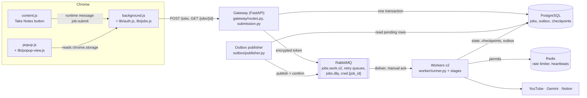
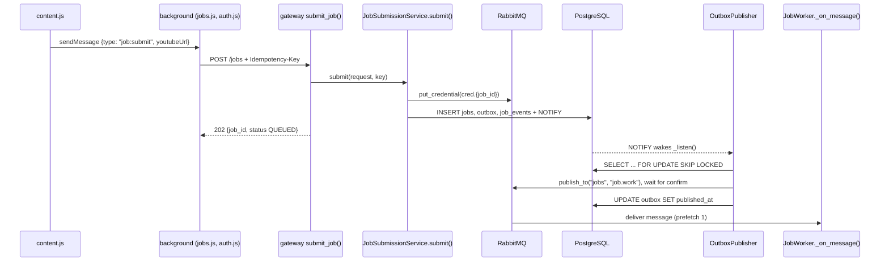
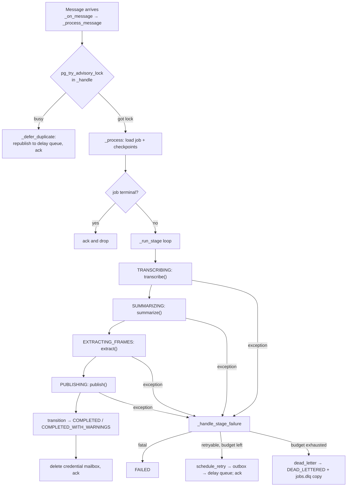
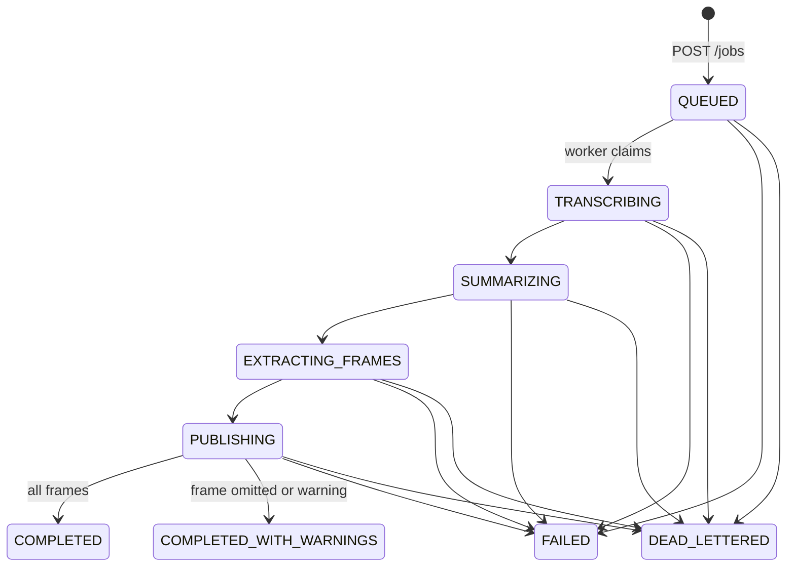
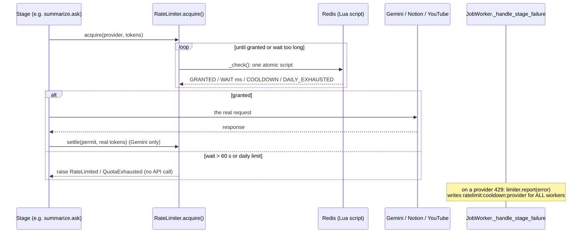

# Codebase and Workflow Guide: Video Notes Agent

A beginner-friendly explanation of **how this project is implemented**: every important file, every
function, how they connect, the commands to run and debug the system, and the full path of a job from
the **Take Notes** button on YouTube to the finished Notion page.

> **How this guide was made.** Everything here was read from the actual source code on branch
> `phase-2` (commit `395643b`), not from file names or the README alone:
> - backend: 46 Python modules, 342 functions and methods;
> - extension: 9 JavaScript files;
> - 4 SQL migrations;
> - `docker-compose.yml`.
>
> Where something could not be confirmed from the code it is marked **Unclear**. Project status
> (what was verified live versus only in tests) comes from `docs/PROJECT_STATUS_AND_HANDOVER.md`.

---

## Table of Contents

1. [How to read this guide](#1-how-to-read-this-guide)
2. [Key concepts in simple language](#2-key-concepts-in-simple-language)
3. [Architecture diagrams](#3-architecture-diagrams)
4. [Folder and file structure](#4-folder-and-file-structure)
5. [The complete workflow: from Take Notes to Notion](#5-the-complete-workflow-from-take-notes-to-notion)
6. [Failure handling explained](#6-failure-handling-explained)
7. [Function reference: backend `common/` (shared code)](#7-function-reference-backend-common-shared-code)
8. [Function reference: API gateway](#8-function-reference-api-gateway)
9. [Function reference: outbox publisher](#9-function-reference-outbox-publisher)
10. [Function reference: worker and pipeline stages](#10-function-reference-worker-and-pipeline-stages)
11. [Function reference: operator tools (`ops/`) and scripts](#11-function-reference-operator-tools-ops-and-scripts)
12. [Function reference: Chrome extension](#12-function-reference-chrome-extension)
13. [Tests: what they are and how they are organised](#13-tests-what-they-are-and-how-they-are-organised)
14. [Command reference](#14-command-reference)
15. [Debugging and troubleshooting](#15-debugging-and-troubleshooting)
16. [Unclear points and documentation limits](#16-unclear-points-and-documentation-limits)

---

## 1. How to read this guide

- **New to the project:** read Sections 2 → 3 → 5. They explain the ideas, the pictures and the path
  of one job.
- **Opening a source file:** look it up in Section 4 (what the file is for), then in Sections 7–12
  (every function in it).
- **Running or debugging something:** go to Sections 14 and 15.

**Conventions used:**
- `name()` means a function or method written in **our** code.
- *Library calls* (FastAPI, aio-pika, psycopg, redis-py, google-genai, yt-dlp, httpx, Chrome APIs) are
  written as e.g. *library: `aio_pika.connect_robust`*, so they are never confused with project
  functions.
- File paths are relative to the project root. Backend Python paths are under
  `backend/notesagent/…`; the Python import name is `notesagent.…`.
- **Workflow position** refers to the numbered steps of Section 5 (Step 1 = click, … Step 13 =
  popup).

---

## 2. Key concepts in simple language

Each concept is defined first, then shown as it is **actually used here**.

### 2.1 Process, container and service

- **Process:** a running program.
- **Container:** a small isolated box that runs one process with its own installed software (Docker
  creates containers from *images*, which are snapshots of the installed software).
- **Service:** a named kind of container in `docker-compose.yml`, for example `worker`. One service can
  run several containers (replicas).

**In this project:** the services are
- `postgres`, `rabbitmq`, `redis` (data and messaging);
- `migrate` (runs once, creates the database tables);
- `gateway`, `outbox-publisher`, `worker` (our Python code);
- `tests` (only with the `test` profile).

All our Python services use **one image**, `notes-agent-backend:dev`, built from `backend/Dockerfile`,
and differ only in the command they start, for example `python -m notesagent.worker`.

### 2.2 Docker Compose

**Definition:** Docker Compose is a tool that reads one file (`docker-compose.yml`) and starts,
stops, connects and scales all the containers of an application together.

**In this project:**
- `docker compose up -d` starts the whole stack.
- `docker compose up -d --no-deps --scale worker=3 worker` changes only the number of worker
  containers.
- Compose also substitutes values from `.env` (the secret configuration file, never committed) into
  the containers' environment variables.

### 2.3 FastAPI (the API gateway)

**Definitions:**
- An **API** is a set of URLs that programs call to ask for something.
- **FastAPI** is a Python web framework: you write a function, decorate it with
  `@router.post("/jobs")`, and FastAPI calls it when an HTTP request for that URL arrives.

**In this project:** the gateway (`gateway/`) is a FastAPI app with these endpoints:
- `POST /jobs` (submit);
- `GET /jobs/{id}` (status);
- `GET /jobs/{id}/results`;
- `GET /healthz`;
- `GET /livez`;
- two Notion sign-in endpoints.

It **never processes videos**: it only records jobs and answers questions about them.

### 2.4 PostgreSQL (the database)

**Definitions:**
- **PostgreSQL** is a relational database: data lives in tables of rows and columns, changed with SQL.
- A **transaction** groups several changes so that **either all of them happen or none do**.

**In this project:** PostgreSQL stores every job and its history. The tables, created by
`backend/migrations/*.sql`, are:
- `jobs`, `job_events`, `job_checkpoints`;
- `outbox`, `idempotency_keys`;
- `dead_letter_audit`, `job_status_transitions`.

A database **trigger** (`enforce_job_transition`) refuses illegal status changes even if Python had a
bug.

### 2.5 Transactional outbox

**The problem:** the gateway must both *save the job* (PostgreSQL) and *send a message* (RabbitMQ).
Two separate systems cannot be updated atomically. A crash in between would lose the job or create a
message for a job that does not exist.

**The fix:**
- The gateway writes the job **and** an `outbox` row ("please send this message") in **one PostgreSQL
  transaction**.
- A separate process, the **outbox publisher**, later reads pending outbox rows, sends them to
  RabbitMQ, waits for RabbitMQ to confirm, and only then marks the rows as sent.
- If it crashes in between, the row is sent again. The message may arrive twice, which the workers
  tolerate (Section 2.9).

**In this project:** used for new jobs, for retry scheduling and for dead-letter copies. No component
ever writes to both systems as two separate steps.

### 2.6 RabbitMQ, queues and durable messages

**Definitions:**
- A **message broker** is a post office for programs: producers drop messages into **queues**, and
  consumers take them out.
- **Durable / persistent** messages are written to disk, so they survive a broker restart.
- An **acknowledgement (ack)** is the consumer saying "I'm done with this message, delete it".
- A message that was delivered but **not acked** goes back to the queue if the consumer disappears.

**In this project:** RabbitMQ 4.4.1 with *quorum queues* (a replicated, crash-safe queue type):

| Queue | Purpose |
|---|---|
| `jobs.work.v2` | Jobs waiting for a worker |
| `jobs.retry.5s`, `10s`, `30s`, `90s` | Waiting rooms for retries. Each message expires after N seconds and is then sent back to the work queue |
| `jobs.dlq` | Dead-letter queue: jobs that gave up, kept for inspection |
| `jobs.dlq.audit`, `jobs.dlq.audit.parked` | Help record broker-initiated dead letters in the database |
| `cred.<job_id>` | One small queue per job holding the **encrypted Notion token** (the *credential mailbox*) |

### 2.7 Multiple workers

**Definition:** a **worker** is a process that takes a job message, does the heavy work, and records
the result.

**In this project:**
- **How many:** two worker containers by default (`worker-1`, `worker-2`), each processing **one job at
  a time** (`prefetch_count=1`).
- **Same code:** both run the same code. Any worker can run any stage.
- **Scaling:** adding workers (`--scale worker=3`) increases throughput without code changes.

### 2.8 Redis (shared rate limiter)

**Definitions:**
- **Redis** is a very fast in-memory key–value store.
- A **rate limiter** makes sure we do not call an external API more often than allowed. If each
  worker limited itself separately, two workers would together exceed the limit, so the limiter must
  be **shared**.

**In this project, Redis holds:**
- the shared rate-limit counters (Gemini: 4 requests/min, 200,000 input tokens/min, 16 requests/day;
  Notion: 2.5 requests/s per connection; YouTube: cooldown only);
- "cooldowns" after a provider says 429;
- worker heartbeats, which `/healthz` counts;
- single-use Notion sign-in `state` values.

Each limiter check is one **Lua script** run atomically inside Redis.

### 2.9 At-least-once delivery and idempotency

**Definitions:**
- **At-least-once delivery:** RabbitMQ guarantees a message is delivered *at least* once, never lost,
  but it may sometimes be delivered **twice** (for example after a crash).
- **Idempotent:** an operation is idempotent if doing it twice has the same effect as doing it once.

**In this project, duplicates are made harmless by:**
- a per-job **PostgreSQL advisory lock** (only one worker works on a job at a time);
- **compare-and-set** status updates (`UPDATE … WHERE status = 'expected'`, so only the first one
  succeeds);
- **checkpoints** (a finished stage is not repeated);
- an **Idempotency-Key** on `POST /jobs` (a repeated submission returns the same job);
- **Notion reconciliation** (before writing, the worker looks for this job's existing page, so it
  never creates a second one).

### 2.10 Retries and dead-letter queues

**Definitions:**
- A **retry** is trying a failed step again later.
- **Backoff** is waiting longer between retries.
- A **dead-letter queue (DLQ)** is where messages go when they keep failing, so they stop being
  retried forever and a human can inspect them.

**In this project:**
- Errors are **classified** (`common/errors.py`, `common/http_errors.py`):
  - *fatal* errors (for example a private video or a video over 20 minutes) end the job as `FAILED`
    immediately;
  - *retryable* errors (429, 5xx, network) are retried after 10 s, 30 s, 90 s… (Gemini 503/504: 60 s,
    180 s, 600 s);
  - retries are limited to `MAX_ATTEMPTS` (default 5) executions in total, after which the job
    becomes `DEAD_LETTERED` and a copy goes to `jobs.dlq`.

### 2.11 Checkpoints

**Definition:** a **checkpoint** is a saved result of a finished stage.

**In this project:** after each stage the worker stores its output in `job_checkpoints` **in the same
transaction** as the status change. If a worker dies, the next worker continues at the first stage
without a checkpoint.

### 2.12 Gemini API

**Definition:** Google's large language model service.

**In this project:**
- `worker/gemini.py` calls it through the official `google-genai` SDK, model `gemini-3.5-flash-lite`.
- It asks for **JSON** following a schema: summary, key points, sections, important moments with
  captions.
- The transcript is sent as numbered segments, and Gemini must answer with segment **numbers**. This
  stops it from inventing timestamps.

### 2.13 yt-dlp and youtube-transcript-api

Both are open-source Python libraries, **not official Google APIs**; they may break if YouTube
changes.
- **yt-dlp** reads YouTube metadata (title, true duration) and downloads the video stream.
- **youtube-transcript-api** fetches the timestamped captions.

**In this project:** used in `worker/youtube.py` (the `YouTubeClient` class).

### 2.14 FFmpeg and ffprobe

- **FFmpeg** is a command-line program that decodes and encodes video and images.
- **ffprobe**, from the same package, inspects a media file.

**In this project:** `worker/frames.py` runs `ffmpeg -ss <time> -i <video> -frames:v 1 …` to capture
**one real frame** at each timestamp, then `ffprobe` to confirm it is a valid JPEG. Images are
**never AI-generated**.

### 2.15 Notion API

Notion's REST API for creating pages, blocks and file uploads.

**In this project:**
- `worker/notion.py` (`NotionClient`) uploads the frames and creates the page.
- The user's permission comes from **OAuth**: a "Sign in with Notion" flow; the gateway exchanges the
  code for a token (`gateway/oauth.py`).

### 2.16 Chrome Manifest V3 extension

**Definition:** a Chrome extension is a bundle of HTML/JavaScript files described by `manifest.json`;
Manifest V3 is the current format. Its parts:
- a **content script** runs *inside* web pages (here: YouTube);
- a **background service worker** runs in the background (it can be stopped and restarted by Chrome
  at any time);
- a **popup** is the small window opened from the toolbar icon.

**In this project:**
- `content.js` adds the button;
- `background.js` plus `lib/*.js` talk to the gateway;
- `popup.html`/`popup.js` show progress.

There is **no build step**: Chrome loads the folder directly.

---

## 3. Architecture diagrams

### 3.1 The four components and supporting services



**Reading the diagram:**
- The browser only talks to the gateway.
- The gateway only writes to PostgreSQL and the credential mailbox.
- The outbox publisher moves messages from PostgreSQL to RabbitMQ.
- Workers do all the slow work and are the only ones calling YouTube, Gemini and Notion (the gateway
  calls Notion once during sign-in).

### 3.2 Job submission and message delivery



### 3.3 Worker processing pipeline



Each stage's output is saved as a checkpoint with the next status (`jobs_repo.transition`) before the
next stage starts.

### 3.4 Job state lifecycle



**How the transitions are enforced:**
- The 16 allowed transitions are defined in `common/states.py` (`ALLOWED_TRANSITIONS`).
- They are enforced twice: in Python (`can_transition`) and in PostgreSQL (trigger
  `jobs_enforce_transition`).
- While a retry is waiting, the status stays at the current stage, and the `retry` column and API
  field are filled.

### 3.5 External API rate-limiting flow



The provider is **never called without a permit**. If Redis itself is down, `acquire` raises
`RateLimiterUnavailable`, and the job is retried on a separate "infrastructure" budget.

---

## 4. Folder and file structure

```
Project/
├── docker-compose.yml        all services, their configuration and health checks
├── .env.example              list of every setting (copy to .env; .env holds secrets, never committed)
├── backend/
│   ├── Dockerfile            builds the one Python image (targets: runtime, test)
│   ├── requirements*.txt     pinned Python dependencies
│   ├── pytest.ini            test runner settings
│   ├── infra/rabbitmq/rabbitmq.conf   RabbitMQ settings (e.g. consumer timeout)
│   ├── migrations/001…004_*.sql       database schema, applied in order
│   ├── notesagent/
│   │   ├── common/           code shared by gateway, publisher and workers
│   │   ├── gateway/          the FastAPI API gateway
│   │   ├── outbox/           the outbox publisher process
│   │   ├── worker/           the job worker and the four pipeline stages
│   │   └── ops/              operator command-line tools (demo faults, queue migration)
│   └── tests/                pytest suite (+ tests/support/ helpers and fake providers)
├── extension/                Chrome extension (Manifest V3, no build step)
│   ├── manifest.json, config.js, background.js, content.js, popup.html/.js/.css, content.css
│   ├── lib/                  auth.js, gateway.js, jobs.js, popup-view.js
│   └── tests/                Node.js tests (fake chrome API, fake gateway)
├── scripts/migrate_work_queue.py      host wrapper for the queue migration tool
└── docs/                     status, decisions (ADRs), API, runbook, report, session logs
```

**Files deliberately not explained:** the empty `__init__.py` package markers, `requirements*.txt`
(pinned third-party versions), `.gitattributes` and `.gitignore`, generated folders such as
`backend/test-artifacts/`, and documentation files (described in their own headers).

### 4.1 Configuration and infrastructure files

| File path | Purpose | Responsibility | Important contents | Connections | Workflow position |
|---|---|---|---|---|---|
| `docker-compose.yml` | Defines the whole running system | Starts and connects containers; injects settings from `.env`; health checks | Services `postgres` (16), `rabbitmq` (4.4.1-management, UI on `127.0.0.1:15672`), `redis` (7-alpine), `migrate`, `gateway` (port `127.0.0.1:${GATEWAY_PORT:-8000}`), `outbox-publisher`, `worker`, `tests` (profile `test`); volumes `pgdata`, `rabbitmqdata`, `redisdata` | Reads `.env`; starts the Python entry points | Everything |
| `.env.example` | Documents every environment variable (no secrets) | Template for `.env` | DB/broker/Redis URLs, Gemini key and limits, Notion OAuth settings, retry/backoff, frames, demo switch | Read by humans; `.env` is read by Compose | Setup |
| `backend/Dockerfile` | Builds the Python image | Installs Python 3.12, FFmpeg and dependencies; runs as user `app` | Stages `base` → `runtime` (default `CMD python -m notesagent.worker`) and `test` (`CMD pytest`) | Used by `docker compose build` | Build time |
| `backend/infra/rabbitmq/rabbitmq.conf` | RabbitMQ server settings | Mounted into the broker container | Memory limit 512 MiB, memory watermark 0.6, disk-free limit 500 MB, `consumer_timeout = 3600000` (1 hour: how long a message may stay unacknowledged) | `docker-compose.yml` | Broker |
| `backend/migrations/001_init.sql` | Initial schema | Creates `jobs`, `job_events`, `job_checkpoints`, `outbox`, `idempotency_keys`, `job_status_transitions`, trigger `jobs_enforce_transition` (function `enforce_job_transition`) | Tables, indexes, transition table | Applied by `common/migrate.py` | Steps 3–7 |
| `backend/migrations/002_result_integrity.sql` | Result rules | CHECK constraints `jobs_result_only_on_success`, `jobs_result_shape`, `jobs_error_only_on_failure`: only finished jobs carry `result` (with the expected shape); only failed ones carry `error` | Constraints | Same | Steps 12–13 |
| `backend/migrations/003_retry_dlq_foundation.sql` | Retries and DLQ columns | Adds outbox destination columns (exchange limited to `jobs`, `jobs.retry`, `jobs.dlx`), the `infra_attempts` counter, and the `dead_letter_audit` table. The `retry` and `attempts` columns already exist from 001 | Columns, constraints | Same | Section 6 |
| `backend/migrations/004_dead_letter_audit_outcomes.sql` | Audit outcomes | Extends the allowed outcomes of `dead_letter_audit` | Constraint update | Same | Section 6 |
| `backend/pytest.ini` | pytest settings | `testpaths = tests`, prints the 10 slowest tests, ignores deprecation warnings | — | `tests` container | Testing |
| `extension/manifest.json` | Declares the extension | Permissions `identity`, `storage`; host permission `http://localhost:8000/*`; background module; popup; content script on `https://www.youtube.com/*` | Manifest V3 keys (plus a public `key` for a fixed extension ID) | Chrome | Steps 1, 2, 13 |
| `extension/config.js` | Extension constants | `GATEWAY_BASE_URL = "http://localhost:8000"`, `NOTION_REDIRECT_PATH = "notion"`, `REQUEST_TIMEOUT_MS = 30000` | 3 exports | Imported by `background.js` | Steps 2, 13 |
| `extension/package.json` | Node test config only | `npm test` → `node --test "tests/*.test.js"` | No dependencies | Node | Testing |

### 4.2 Backend: `common/` (shared by all Python services)

| File path | Purpose | Responsibility | Important contents | Connections | Workflow position |
|---|---|---|---|---|---|
| `common/config.py` | All settings in one typed object | Reads environment variables, validates them, never prints secret values | `Settings` (≈ 90 fields + validators/properties), `MigrationSettings`, `load_settings()`, `get_settings()` | Used by every module | All |
| `common/db.py` | Database connection pool | Opens a pool of autocommit connections returning dict rows | `open_pool()` | gateway `main.py`, `publisher.py`, `runner.py` | Steps 3–7, 13 |
| `common/broker.py` | Everything about RabbitMQ | Queue/exchange names; declares the topology; publishes with confirms; credential mailbox | Constants (`QUEUE_WORK = "jobs.work.v2"`, …), `declare_topology()`, `BrokerClient` | gateway, publisher, worker, auditor, ops | Steps 3, 5, 6, 12 |
| `common/jobs_repo.py` | All SQL about jobs | Insert/read jobs; compare-and-set `transition()`; retry and dead-letter transactions; idempotency keys; audit rows | `transition()`, `schedule_retry()`, `dead_letter()`, `insert_job()`, `insert_outbox()`, … | gateway, worker, auditor | Steps 3, 4, 7–12 |
| `common/states.py` | The job state machine | Allowed statuses, transitions, progress % | `JobStatus`, `ALLOWED_TRANSITIONS`, `is_terminal()`, `can_transition()`, `next_stage()`, `progress_for()` | jobs_repo, runner, routes, dead_letters | Steps 7–12 |
| `common/errors.py` | Error types | API errors and classified pipeline errors (fatal / transient / rate-limited / quota / limiter) | `ApiError`, `PipelineError` and subclasses, `Provider`, `RetryBudget` | Everywhere | Section 6 |
| `common/http_errors.py` | Turning HTTP failures into error types | Pure classifier for HTTP status codes and exceptions, per provider | `classify_http()`, `classify_exception()`, `parse_retry_after()`, `next_pacific_midnight()` | gemini.py, notion.py, youtube.py, runner, ratelimit | Section 6 |
| `common/ratelimit.py` | Shared rate limiter | Atomic Redis Lua checks for Gemini, Notion, YouTube; shared cooldowns | `RateLimiter` (`acquire`, `settle`, `report`), `Permit`, `pacific_day()` | All stages, `NotionClient`, `oauth.py`, runner | Steps 8, 10–12 |
| `common/crypto.py` | Encryption | Encrypts the Notion token for the mailbox; seals OAuth tokens for the extension; idempotency fingerprints | `CredentialCipher`, `TokenSealer`, `CredentialError` | gateway, runner | Steps 3, 12 |
| `common/logging.py` | Safe structured logs | JSON log lines with secret redaction | `setup_logging()`, `redact()`, `RedactingJsonFormatter` | All entry points | All |
| `common/migrate.py` | Applies SQL migrations | Runs each `migrations/*.sql` once, records it in `schema_migrations` | `apply_migrations()`, `main()` | `migrate` service | Start-up |
| `common/runtime.py` | Service runner | Runs an async service until SIGTERM/SIGINT | `run_service()` | outbox and worker entry points | Start-up/shutdown |

### 4.3 Backend: `gateway/` (the API)

| File path | Purpose | Responsibility | Important contents | Connections | Workflow position |
|---|---|---|---|---|---|
| `gateway/__main__.py` | Start command | `python -m notesagent.gateway` → Uvicorn server on port 8000 | `main()` | Compose `gateway` service | Start-up |
| `gateway/main.py` | Builds the FastAPI app | Opens pool, broker, Redis at start-up; exception handlers that return `{"error": {...}}` | `create_app()`, `lifespan()`, handlers | Uvicorn (factory), routes, oauth, submission | Steps 2–3, 13 |
| `gateway/routes.py` | REST endpoints | `POST /jobs`, `GET /jobs/{id}`, `GET /jobs/{id}/results`, `/healthz`, `/livez` | `submit_job()`, `get_job()`, `get_job_results()`, `healthz()`, `livez()`, `job_status_view()` | submission, validation, jobs_repo, health | Steps 3, 13 |
| `gateway/validation.py` | Input checking | JSON body, required fields, idempotency key and job-ID format | `SubmitJobBody`, `SubmitJobRequest`, `read_json_body()`, `parse_submit_request()`, `validate_idempotency_key()`, `parse_job_id()` | routes | Step 3 |
| `gateway/youtube.py` | URL parsing | Extracts the 11-character video ID from YouTube URLs | `extract_video_id()`, `InvalidYouTubeUrl` | validation | Step 3 |
| `gateway/submission.py` | Creates jobs | Mailbox + one DB transaction (job, outbox row, event, idempotency key) + NOTIFY | `JobSubmissionService` (`submit()` …), `SubmitOutcome` | routes, broker, jobs_repo, crypto | Steps 3–4 |
| `gateway/health.py` | `/healthz` checks | Checks PostgreSQL (and pending outbox), RabbitMQ (work-queue messages and consumers) and Redis (live worker heartbeats) in parallel | `check_health()` and helpers | routes | Debugging |
| `gateway/oauth.py` | Notion sign-in | Issues the authorisation URL and state; exchanges the code; returns a **sealed** token | `start_authorization()`, `finish_authorization()`, `_exchange()` | extension `lib/auth.js`, Redis, crypto, limiter | Before Step 1 (one-time) |

### 4.4 Backend: `outbox/`

| File path | Purpose | Responsibility | Important contents | Connections | Workflow position |
|---|---|---|---|---|---|
| `outbox/__main__.py` | Start command | `python -m notesagent.outbox` | `main()` | Compose `outbox-publisher` | Start-up |
| `outbox/publisher.py` | The outbox publisher | Reads unpublished outbox rows, publishes with confirms, marks them published; wakes on NOTIFY | `OutboxPublisher` (`run`, `publish_one`, `drain`, `_listen`) | jobs_repo (rows), broker | Step 5 (and retries, DLQ copies) |

### 4.5 Backend: `worker/`

| File path | Purpose | Responsibility | Important contents | Connections | Workflow position |
|---|---|---|---|---|---|
| `worker/__main__.py` | Start command | `python -m notesagent.worker` → builds stages, runs `JobWorker` | `main()`, `serve()` | Compose `worker` service | Start-up |
| `worker/runner.py` | **The orchestrator** | Consumes messages, locks jobs, runs stages in order, saves checkpoints, handles failures, acks | `JobWorker` (`run`, `_handle`, `_process`, `_run_stage`, `_handle_stage_failure`, …), `validate_publish_result()` | Everything in `worker/` and `common/` | Steps 6–12 |
| `worker/stages.py` | Stage contract | Defines what a stage receives (`StageContext`) and returns (`StageOutput`); builds the registry | `build_stage_registry()` | runner; the four stage modules | Step 7 |
| `worker/transcribe.py` | Stage 1: TRANSCRIBING | Metadata, 20-minute check, transcript | `make_transcribe_stage()`, `check_duration()`, `select_transcript()`, `to_segments()` | youtube.py, limiter | Steps 8–9 |
| `worker/youtube.py` | YouTube client and error mapping | yt-dlp metadata and video download; transcript API; classifies YouTube errors | `YouTubeClient`, `classify_metadata_error()`, `classify_transcript_error()` | transcribe.py, frames.py | Steps 8, 11 |
| `worker/summarize.py` | Stage 2: SUMMARIZING | Chunks the transcript, asks Gemini, validates and grounds the answer | `make_summarize_stage()`, `chunk_segments()`, `normalize_chunk()`, `select_moments()` | gemini.py, limiter | Step 10 |
| `worker/gemini.py` | Gemini client | Calls the google-genai SDK with JSON schema output; classifies Gemini errors | `GeminiClient`, `classify_gemini_error()` | summarize.py | Step 10 |
| `worker/frames.py` | Stage 3: EXTRACTING_FRAMES | Downloads the stream, FFmpeg frame per timestamp, validation, degradation | `make_frames_stage()`, `extract_frame()`, `probe_image()`, `purge_stale()` | youtube.py, limiter | Step 11 |
| `worker/publish.py` | Stage 4: PUBLISHING | Builds the Notion block plan; finds or creates the page; uploads frames; appends blocks | `make_publish_stage()`, `build_plan()`, `find_existing_page()` | notion.py, runner | Step 12 |
| `worker/notion.py` | Notion client | Every Notion HTTP call, each after a limiter permit; error classification | `NotionClient` | publish.py | Step 12 |
| `worker/retry_policy.py` | Retry decisions (pure) | Decides retry vs dead-letter, the delay and the delay queue | `plan_failure()`, `choose_bucket()`, `public_retry_view()` | runner, routes | Section 6 |
| `worker/dlq_audit.py` | Broker dead-letter auditor | Consumes `jobs.dlq.audit`; records broker dead letters in PostgreSQL | `DeadLetterAuditor` | runner (starts it), dead_letters, jobs_repo | Section 6 |
| `worker/dead_letters.py` | Rules for the auditor (pure) | Parses dead-letter headers; decides the outcome | `parse()`, `decide()`, `job_error()` | dlq_audit | Section 6 |
| `worker/demo_faults.py` | Demo fault switch (ADR-22) | When enabled and armed, raises realistic errors at provider boundaries for live demonstrations | `DemoFaults`, `Scenario` | runner, transcribe, summarize, frames | Demonstrations only (off by default) |

### 4.6 Backend: `ops/` and `scripts/`

| File path | Purpose | Responsibility | Important contents | Connections | Workflow position |
|---|---|---|---|---|---|
| `ops/demo_faults.py` | CLI to arm demo faults | `arm`, `disarm`, `status`; refuses unless the switch is on | `main()` | Redis; worker container | Demonstrations |
| `ops/work_queue_migration.py` | One-time queue migration tool (ADR-09) | Safely replaces the Phase 1 queue `jobs.work` with `jobs.work.v2` | `migrate()`, `main()` and helpers | `ops/rabbitmq_mgmt.py`, broker | Maintenance only |
| `ops/rabbitmq_mgmt.py` | RabbitMQ management HTTP client | Reads queues, bindings and policies; writes the write-block policy | `ManagementApi` | work_queue_migration | Maintenance only |
| `scripts/migrate_work_queue.py` | Host wrapper | Runs the migration tool inside the worker image via `docker compose run` | — | ops/work_queue_migration | Maintenance only |

### 4.7 Chrome extension

| File path | Purpose | Responsibility | Important contents | Connections | Workflow position |
|---|---|---|---|---|---|
| `extension/content.js` (+ `content.css`) | The Take Notes button on YouTube | Inserts and syncs the button; sends `job:submit` | `createTakeNotes()` → `sync`, `onClick`, `render`, `start`, `stop` | background via `chrome.runtime.sendMessage` | Step 1 |
| `extension/background.js` | Service worker entry | Builds the auth service and job tracker; routes runtime messages; resumes polling | message listener, `showNotionRedirectUri()` | lib/auth.js, lib/jobs.js, config.js | Steps 2, 13 |
| `extension/lib/gateway.js` | HTTP helper | `fetch` with timeout; turns gateway errors into `ExtensionError(code)` | `callGateway()`, `ExtensionError` | auth.js, jobs.js | Steps 2, 13 |
| `extension/lib/auth.js` | Notion sign-in and job submission | OAuth flow via the gateway; stores only the sealed token; `POST /jobs` | `createAuthService()`, `createMessageHandler()`, `parseRedirect()` | gateway.js, background.js | One-time sign-in; Step 2 |
| `extension/lib/jobs.js` | Job tracker | Duplicate prevention, idempotency keys, one polling loop, storage | `createJobTracker()`, `sanitizeStatus()`, `videoIdFromUrl()` | auth.js, gateway.js, background.js | Steps 2, 13 |
| `extension/lib/popup-view.js` | Turns job data into display text (pure) | Stage marks, headlines, readable errors and warnings, safe Notion link | `describeJob()`, `describeConnection()`, `reasonText()` | popup.js | Step 13 |
| `extension/popup.html` / `popup.js` / `popup.css` | The popup window | Connect/Disconnect button; renders tracked jobs; re-renders on storage changes | `refresh()`, `renderJobs()`, `renderJob()` | popup-view.js, background (messages) | Step 13 |

---

## 5. The complete workflow: from Take Notes to Notion

**Before Step 1 (one time only): Notion sign-in.**
1. The popup's **Connect Notion** button sends `{type: "auth:signIn"}` to the background.
2. `createAuthService().signIn()` → `runSignIn()` → `flow()`, which calls
   `POST /oauth/notion/authorize` (gateway `start_authorization()`).
3. It opens Notion's consent page with *Chrome: `chrome.identity.launchWebAuthFlow`*.
4. It checks the returned `state`, then calls `POST /oauth/notion/callback` (gateway
   `finish_authorization()` → `_exchange()` with Notion → `TokenSealer.seal()`).
5. It stores the **sealed** token (`nva1.…`) in `chrome.storage.local["notionAuth"]`.

The raw Notion token never reaches the browser.

**Main path:**

| Step | What happens | File(s) | Function(s) | Data in → out | Who triggers the next step |
|---|---|---|---|---|---|
| 1 | User clicks **Take Notes** | `extension/content.js` | `onClick()` (bound by `sync()`), `currentVideoId()`, `render()` | Page URL → message `{type: "job:submit", youtubeUrl}` | *Chrome: `chrome.runtime.sendMessage`* wakes the background |
| 2 | Extension submits the job | `background.js`, `lib/auth.js`, `lib/jobs.js`, `lib/gateway.js` | listener → `createMessageHandler()` handler → `jobs.submit()` → `submitOnce()` → `auth.submitJob()` → `callGateway()` | `youtubeUrl` → HTTP `POST /jobs` with JSON `{youtube_url, notion_token: sealed}` and header `Idempotency-Key: vna:<videoId>:<uuid>` | The HTTP request reaches FastAPI |
| 3 | Gateway validates and creates the job | `gateway/routes.py`, `validation.py`, `youtube.py`, `submission.py` | `submit_job()` → `validate_idempotency_key()`, `read_json_body()`, `parse_submit_request()` (→ `extract_video_id()`), then `JobSubmissionService.submit()` | JSON → `SubmitJobRequest(youtube_url, video_id, notion_token, notion_parent_id)` → response **202** `{job_id, status: "QUEUED", video_id}` + `Location` | `submit()` itself performs Step 4 before returning |
| 4 | PostgreSQL and the outbox store the job | `submission.py`, `common/broker.py`, `common/crypto.py`, `common/jobs_repo.py` | `_mailbox_token()` (unseal) → `CredentialCipher.seal()` → `BrokerClient.put_credential()` (queue `cred.<job_id>`, confirmed) → **one transaction**: `claim_idempotency_key()`, `insert_job()`, `insert_outbox()`, `insert_event()`, `pg_notify` | Token → encrypted blob in RabbitMQ; job row `QUEUED`; outbox row `job.submitted` → `jobs`/`job.work` | PostgreSQL `NOTIFY` wakes the outbox publisher |
| 5 | Outbox publisher sends the message | `outbox/publisher.py`, `common/broker.py` | `_listen()` sets `_wake` → `run()` → `drain()` → `publish_one()` → `BrokerClient.publish_to()` | Outbox row → persistent AMQP message (body `{event_id, event_type, job_id, schema}`, `message_id = event_id`, header `x-job-id`) → row marked `published_at` | RabbitMQ delivers to a consumer |
| 6 | RabbitMQ delivers to a free worker | RabbitMQ; `worker/runner.py` | *aio-pika* calls `JobWorker._on_message()` (registered in `run()` via `queue.consume`) → `_process_message()` → `_handle()` | Message → `job_id`; per-job advisory lock taken | `_handle()` calls `_process()` |
| 7 | Worker processes the job | `worker/runner.py`, `worker/stages.py`, `common/jobs_repo.py` | `_process()`: `get_job()`; `transition(QUEUED → TRANSCRIBING, event "claimed")`; `get_checkpoints()`; loop `_run_stage()` | Job row + checkpoints → `StageContext` for each stage → `StageOutput` | `_run_stage()` calls the stage function for the current status |
| 8 | YouTube metadata and transcript | `worker/transcribe.py`, `worker/youtube.py` | `transcribe()`: `call(…, youtube.video_info)` → `check_duration()` → `call(…, transcript_list)` → `select_transcript()` → `call(…, fetch)` → `to_segments()` | Video ID → checkpoint `{video_id, title, duration_sec, duration_exact, transcript{…segments}}` + job fields `video_title`, `duration_sec` | `_run_stage()` → `transition(TRANSCRIBING → SUMMARIZING, checkpoint)` |
| 9 | 20-minute check (Constraint A) | `worker/transcribe.py` | `check_duration(raw, settings.max_video_duration_sec)` (inside Step 8, **before** the transcript request) | Duration → OK, or `FatalStageError("VIDEO_TOO_LONG")` / `"VIDEO_DURATION_UNKNOWN"` → job `FAILED` | On error: `_handle_stage_failure()` |
| 10 | Gemini generates study notes | `worker/summarize.py`, `worker/gemini.py` | `summarize()`: `chunk_segments()` → per chunk `ask()` (limiter `acquire` → `GeminiClient.generate()` → `settle`) → `normalize_chunk()`; if several chunks, a merge `ask()`; `select_moments()` | Segments → checkpoint `{summary, key_points, sections, important_timestamps[…caption, reason], chunk_count, gemini_requests, usage, validation}` | `transition(SUMMARIZING → EXTRACTING_FRAMES)` |
| 11 | FFmpeg extracts real frames | `worker/frames.py`, `worker/youtube.py` | `extract()` → `purge_stale()` → `_extract_into()`: limiter `acquire(YOUTUBE)` → `YouTubeClient.download_video()` → `probe_duration()` → for each moment `valid_timestamp()` → `extract_frame()` (→ `probe_image()`) → `_output()` | Moments → checkpoint `{requested, extracted, frames[{timestamp_sec, caption, reason, image{…data_base64}}], failed[…], source}` + warnings `FRAME_EXTRACTION_FAILED` | `transition(EXTRACTING_FRAMES → PUBLISHING)` |
| 12 | Notion publisher creates the page | `worker/publish.py`, `worker/notion.py`, `runner.py` | `publish()`: `build_plan()` → `ctx.get_notion_token()` (→ `_read_credential()` → `peek_credential()` → `CredentialCipher.open()`) → `find_existing_page()` → `all_children()` → `materialize()` (→ `upload_image()`) → `create_page()` / `append_children()` → `retrieve_page()` | Checkpoints → Notion page; result `{notion_page_url, frames_requested, frames_published}` | `_run_stage()` → `validate_publish_result()` → `transition(PUBLISHING → COMPLETED or COMPLETED_WITH_WARNINGS, result, warnings)`; then `_process()` deletes the mailbox (`_cleanup_credential()`) and **acks** |
| 13 | Extension polls and shows progress | `lib/jobs.js`, `lib/gateway.js`, gateway `routes.py`, `popup.js`, `lib/popup-view.js` | `tick()` → `pollOne()` → `callGateway("GET /jobs/{id}")` → gateway `get_job()` → `_load_job()` → `job_status_view()`; then `sanitizeStatus()` → storage; `popup.js` `renderJobs()` → `describeJob()` | Job row → JSON `{status, progress, video_title, warnings, error, result, retry, …}` → `chrome.storage.local["jobs"]` → popup text and the "View in Notion" link | Polling repeats every 3 s (10 s during a retry) until the job is terminal |

### 5.1 Step details worth knowing

**Step 2: duplicate prevention in the extension (`lib/jobs.js`):**
- **Same video already running:** if a tracked job for this video is still running, `submitOnce()`
  returns it (`alreadyTracking: true`) and sends nothing.
- **Double clicks:** they share one promise (the `submitting` map).
- **Idempotency key:** stored in `chrome.storage.local["pendingSubmissions"]` until the outcome is
  known. After a network error the **same key** is reused, so the gateway replays the first result
  instead of creating a second job.

**Step 4: why the token goes to RabbitMQ, not PostgreSQL:**
- The specification says the gateway must not store the token.
- It is encrypted (`CredentialCipher.seal`, bound to the job ID) and parked in the per-job queue
  `cred.<job_id>`, which expires after `CREDENTIAL_TTL_HOURS` (default 24).
- The worker reads it **without consuming it** (`peek_credential`: get, copy, `nack(requeue=True)`).

**Step 6: what "one job at a time" means:**
- `consume_channel.set_qos(prefetch_count=1)` makes RabbitMQ send at most one unacknowledged message
  per worker.
- `self._slot` (an `asyncio.Lock`) serialises the worker's own message handlers.

**Step 7: claim, retry or resume.** `_process()` distinguishes three cases:
- **New job** (`QUEUED`): transition to `TRANSCRIBING`, event `claimed`.
- **Scheduled retry** (`job["retry"]` set): only the message whose `message_id` equals
  `retry.event_id` may run. If it arrives early, it is re-delayed (`choose_bucket`). Otherwise the
  event `retry_started` is recorded.
- **Redelivered after a crash** (status already past `QUEUED`): event `resumed`. Finished stages are
  skipped because their checkpoints exist.

**Step 10: grounding:**
- Gemini receives lines like `[#42 03:15] text` and must reply with segment numbers.
- `normalize_chunk()` drops any item whose segment number was not in that chunk, and stores the
  segment's **real** start time.

**Step 12: no duplicate pages.**
- `find_existing_page()` lists the parent page's children and looks for a child page with the same
  title whose **first block** contains `job <job_id>` (the marker written by `build_plan()`).
- If it exists, only the missing blocks are written.

**Step 13: progress values** come from `common/states.py` `_PROGRESS`:

| Status | Progress |
|---|---|
| QUEUED | 0 |
| TRANSCRIBING | 10 |
| SUMMARIZING | 30 |
| EXTRACTING_FRAMES | 55 |
| PUBLISHING | 85 |
| COMPLETED / COMPLETED_WITH_WARNINGS | 100 |

---

## 6. Failure handling explained

### 6.1 How an error becomes a decision

**1. Classification.** Every stage exception reaches `JobWorker._handle_stage_failure()`, which calls
`classify_exception()`. A stage normally raises an already-classified `PipelineError`, produced by:
- `classify_http()` for HTTP responses;
- `classify_gemini_error()`, `classify_metadata_error()` or `classify_transcript_error()` for library
  exceptions.

**2. Error classes and their outcomes** (`common/errors.py`):

| Class | Meaning | Example codes | Outcome |
|---|---|---|---|
| `FatalStageError` | Cannot succeed by retrying | `VIDEO_TOO_LONG`, `YOUTUBE_VIDEO_UNAVAILABLE`, `YOUTUBE_TRANSCRIPT_UNAVAILABLE`, `GEMINI_AUTH`, `NOTION_UNAUTHORIZED` | `FAILED` at once |
| `TransientError` | Temporary problem | `GEMINI_HTTP_503`, `YOUTUBE_UNREACHABLE`, `NOTION_UNREACHABLE`, `GEMINI_INVALID_OUTPUT` | Retry (provider budget) |
| `RateLimited` | Provider said 429 / slow down | `GEMINI_RATE_LIMITED`, `YOUTUBE_RATE_LIMITED`, `NOTION_RATE_LIMITED`, plus the limiter's own `*_LOCAL_RATE_LIMIT` / `*_COOLDOWN_ACTIVE` | Retry after at least `retry_after_sec`; shared cooldown |
| `QuotaExhausted` | Daily quota used up | `GEMINI_QUOTA_EXHAUSTED`, `GEMINI_DAILY_LIMIT_REACHED` | Retry (normal step; reset time recorded) |
| `RateLimiterUnavailable` | Redis down; provider NOT called | `RATE_LIMITER_UNAVAILABLE` | Retry on the separate infrastructure budget (`INFRA_MAX_ATTEMPTS`, 20) |

**3. Cooldown and plan.** For retryable errors, `RateLimiter.report()` stores a shared cooldown (for
provider 429 / quota errors only). Then `retry_policy.plan_failure()` decides:
- **Retry:** if attempts remain, it returns a `RetryPlan`: the delay is
  `BACKOFF_SCHEDULE_SEC[attempt−1]` (10, 30, 90; the last step repeats), or the Gemini 503/504
  schedule (60, 180, 600), or longer if `Retry-After` says so.
- **Give up:** if this attempt reaches `MAX_ATTEMPTS` (default 5 *total* executions), it returns a
  `DeadLetterPlan`.

**4. Recording, in one database transaction:**
- **Retry:** `jobs_repo.schedule_retry()` increments `attempts` (compare-and-set), stores the `retry`
  JSON, writes an event and writes an **outbox row** to exchange `jobs.retry` with routing key `<N>s`.
  The runner then raises `_RetryScheduled`, which makes `_process()` ack the current message.
- **Dead-letter:** `jobs_repo.dead_letter()` → status `DEAD_LETTERED`, error `RETRIES_EXHAUSTED` with
  `last_error_code`, plus an outbox row to `jobs.dlx` (the DLQ copy).

**5. The delay:**
- The outbox publisher sends the retry message to `jobs.retry.<N>s`.
- The message waits there until its TTL expires; RabbitMQ then dead-letters it back to `jobs` →
  `jobs.work.v2`.
- If the remaining wait is longer than any bucket, `_process()` re-delays it (*uncounted hops*).

### 6.2 Worker crashes and message redelivery

| Situation | What protects the job |
|---|---|
| Worker killed (SIGKILL) mid-stage | The message was not acked, so RabbitMQ redelivers it when the connection drops. The advisory lock disappears with the dead database session. The next worker's `_process()` records `resumed` and continues from the last checkpoint. **Live-verified** (crash demo, job `6141336d`) |
| Killed after a stage's commit but before the ack | Redelivered; the checkpoint exists, so that stage is not repeated |
| Two copies of the same message | `pg_try_advisory_lock` fails for the second worker → `_defer_duplicate()` republishes it to the lock delay queue (nothing counted). Later it is dropped because the job is terminal, or `retry.event_id` doesn't match |
| Database or broker trouble while recording | `_delay_without_counting()`: confirmed copy to the delay queue, then ack. If that fails too, the message is nacked after a pause |
| A message crashes every worker | RabbitMQ's `x-delivery-limit` (10) dead-letters it; `DeadLetterAuditor` marks the job `DEAD_LETTERED_BY_BROKER` |
| Crash during publishing | `find_existing_page()` finds the half-written page and continues it. **Covered by automated tests only** |

### 6.3 Idempotency, layer by layer

| Layer | Mechanism | Code |
|---|---|---|
| Submission | `Idempotency-Key` + request fingerprint; replay returns the original 202 | `JobSubmissionService.submit()`, `_replay()`, `jobs_repo.claim_idempotency_key()` |
| Outbox | A duplicate publish is possible and accepted; consumers are idempotent | `OutboxPublisher.publish_one()` |
| Worker | Advisory lock, compare-and-set `transition()`, terminal-job drop, `retry.event_id` authorisation | `runner.py`, `jobs_repo.py` |
| Stages | Checkpoints saved with the transition | `jobs_repo.transition(checkpoint=…)` |
| Notion | Marker block + reconciliation before every write | `publish.py` `find_existing_page()`, `build_plan()` |
| Broker auditor | `dedup_key` on `dead_letter_audit`; the compare-and-set cannot succeed twice | `jobs_repo.upsert_dead_letter_audit()` |

### 6.4 Dead-letter queue: two paths

1. **Worker-initiated:** retries exhausted → `dead_letter()` → outbox row → `jobs.dlx` (fanout) →
   `jobs.dlq` (kept for inspection) and `jobs.dlq.audit`. The auditor recognises it as a
   `worker_copy` and just acks.
2. **Broker-initiated:** crash loop or malformed message (`_process_message()` rejects it with
   `requeue=False`) → RabbitMQ dead-letters it to `jobs.dlx` → the auditor `_handle()` → `parse()` →
   `decide()` → `transition(… DEAD_LETTERED)`, recorded in `dead_letter_audit`.

### 6.5 API rate limiting

- **Before every external call:** `RateLimiter.acquire()` (Section 3.5).
- **Waiting inside the worker:** up to `RATE_LIMIT_MAX_WAIT_SEC` (60 s). After that the job is
  re-queued through the normal retry path, with the code `GEMINI_LOCAL_RATE_LIMIT` or
  `…_COOLDOWN_ACTIVE`.
- **Daily Gemini limit:** reaching it raises `QuotaExhausted("GEMINI_DAILY_LIMIT_REACHED")`, and
  Google is not called.

### 6.6 Frame extraction failures (graceful degradation)

- **One timestamp fails** (FFmpeg error, timeout, invalid JPEG, out of range): `_extract_into()`
  catches `FrameError` and adds `{timestamp_sec, reason}` to `failed`. `_output()` turns each failure
  into a warning `FRAME_EXTRACTION_FAILED`.
- **The source video cannot be downloaded for a non-retryable reason**: every timestamp fails with
  `SOURCE_UNAVAILABLE`, and the page is still published **text-only**.
- **Retryable download errors** (429, 403, 5xx, network) raise and are retried.
- **At publishing:** `_run_stage()` sets `COMPLETED_WITH_WARNINGS` when there are warnings or
  `frames_published < frames_requested`.
- **A frame Notion permanently refuses to upload** becomes a note block plus the warning
  `FRAME_UPLOAD_FAILED` (`materialize()`).
- **Live-verified:** 4/7 frames (`frames_partial` demo) and a text-only page (`frames_all` demo).

---

## 7. Function reference: backend `common/` (shared code)

**Two formats are used in Sections 7–12:**
- **Important functions** get a full block: simple meaning, why, inputs, output, inside (steps),
  calls, called by, workflow role.
- **Small helpers** (getters, formatters, one-line checks) are grouped in tables with the same
  information in short form.

"Called by" lists **application** callers. Framework callers (FastAPI, aio-pika, Pydantic, asyncio)
are named explicitly. "Tests only" means no production code calls the function.

### 7.1 `common/config.py`: settings

#### `class Settings(BaseSettings)`

- **Simple meaning:** one Python object holding every configuration value (database URL, Gemini
  limits, backoff schedule, Notion settings, …).
- **Why:** every service reads the same names from environment variables. Pydantic (*library*)
  converts and validates them once at start-up.
- **Inputs:** environment variables, plus keyword overrides used by tests.
- **Output:** a validated `Settings` instance. Secret values (`database_url`, `rabbitmq_url`,
  `redis_url`, `gemini_api_key`, `notion_client_secret`, `job_payload_encryption_key`) are `SecretStr`,
  so printing the object never shows them.
- **Called by:** `get_settings()` and `load_settings()`.
- **Workflow role:** read once by every process at start-up.

**Validators and properties.** Pydantic runs the validators automatically when `Settings` is built;
no application code calls them directly. The properties are read as attributes.

| Name | Kind | Simple meaning (inputs → output) | Used by |
|---|---|---|---|
| `_empty_is_unset` | validator for `notion_client_id`, `notion_redirect_uri` | Turns an empty string into `None` ("not configured") | Pydantic |
| `_empty_secret_is_unset` | validator for `notion_client_secret` | Same, for the secret | Pydantic |
| `_valid_redirect_uri` | validator | Rejects a redirect URI that isn't a proper https URL | Pydantic |
| `_valid_parent_id` | validator for `notion_default_parent_id` | Accepts a 32-hex Notion page ID, or a Notion page URL ending in one; returns the normalised ID | Pydantic |
| `_valid_schedule` | validator for `backoff_schedule_sec`, `gemini_unavailable_backoff_sec` | Requires a comma-separated list of positive integers, e.g. `10,30,90` | Pydantic |
| `_audit_limit_exceeds_carried_count` | model validator (after) | If `AUDIT_QUEUE_DELIVERY_LIMIT` is set it must exceed `QUEUE_DELIVERY_LIMIT + 1` (ADR-12) | Pydantic |
| `_valid_thinking_level` | validator | Allows only `minimal`, `low`, `medium`, `high` (lower-cased) | Pydantic |
| `_valid_limiter_namespace` | validator | Empty, or 1–32 chars `a-z0-9-` (ADR-23); strips whitespace | Pydantic |
| `_valid_model` | validator | Gemini model name may contain only letters, digits, `-._` | Pydantic |
| `_valid_languages` | validator | Validates `TRANSCRIPT_LANGUAGES` (comma-separated codes) | Pydantic |
| `notion_oauth_configured` | property → `bool` | True only if client ID, secret and redirect URI are all set | `gateway/oauth.py` `_configured()` |
| `effective_worker_id` | property → `str` | `WORKER_ID`, or `"<hostname>-<pid>"` (e.g. `da8ed7b01348-1`) | `JobWorker.__init__` |
| `credential_ttl_ms` | property → `int` | `credential_ttl_hours` in milliseconds (mailbox expiry) | `BrokerClient.put_credential()` |
| `transcript_language_list` | property → `list[str]` | Splits `TRANSCRIPT_LANGUAGES` into a list | `transcribe()` |
| `effective_audit_queue_delivery_limit` | property → `int` | The configured audit limit, or `QUEUE_DELIVERY_LIMIT + 11` | `audit_queue_arguments()` |
| `backoff_delays` | property → `list[int]` | Parsed `BACKOFF_SCHEDULE_SEC` | `plan_failure()`, `delay_queue_seconds` |
| `gemini_unavailable_backoff_delays` | property → `list[int]` | Parsed `GEMINI_UNAVAILABLE_BACKOFF_SEC` | `plan_failure()` |
| `delay_queue_seconds` | property → `list[int]` | Every delay that needs a delay queue (backoff steps + lock and infra delays) | `declare_topology()`, `plan_failure()`, `_process()` |

#### `class MigrationSettings(BaseSettings)`

The migration job only needs `database_url` and `log_level`, so it has its own, smaller settings class.
Used by `common/migrate.py` `main()`.

#### `load_settings(cls, **overrides)`

- **Simple meaning:** build a settings object, but if validation fails, print only the *field names
  and error types*, never the values.
- **Why:** Pydantic's default error text includes the input value, which could leak part of a key
  or URL into the logs.
- **Inputs:** a settings class and overrides. **Output:** the instance, or `SystemExit` with a safe
  message.
- **Called by:** `get_settings()`, `migrate.main()`. **Workflow role:** start-up.

#### `get_settings(**overrides) -> Settings`

`load_settings(Settings, **overrides)`.
- **Called by:** every entry point (`gateway/__main__.main`, `outbox/__main__.main`,
  `worker/__main__.serve`), `create_app()`, `build_stage_registry()`, `ops/demo_faults.main`,
  `ops/work_queue_migration.main`.
- **Overrides:** tests pass overrides; the entry points pass `service_name`.

### 7.2 `common/db.py`

#### `async open_pool(settings, *, name, min_size=1, max_size=5, wait=True, timeout=30.0)`

- **Simple meaning:** open a pool of reusable PostgreSQL connections.
- **Why:** opening a connection per request is slow; a pool shares a few open connections.
- **Inside:**
  - *library: psycopg `AsyncConnectionPool`* with `autocommit=True` (each statement commits unless
    inside an explicit `conn.transaction()`) and `row_factory=dict_row` (rows come back as dicts);
  - `pool.open(wait=wait)`.
  - `wait=False` lets the gateway start while the database is still down; `/healthz` then reports it.
- **Output:** the pool.
- **Called by:** `create_app().lifespan` (gateway, `max_size=10`, `wait=False`),
  `OutboxPublisher.open()` (`max_size=2`), `JobWorker.run()` (`max_size=3`).
- **Workflow role:** start-up of each Python service.

### 7.3 `common/states.py`: the state machine

Constants:
- `JobStatus` (an enum of the 9 statuses);
- `PIPELINE_ORDER` (the 4 stages in order);
- `TERMINAL` (COMPLETED, COMPLETED_WITH_WARNINGS, FAILED, DEAD_LETTERED);
- `ALLOWED_TRANSITIONS` (each forward step, plus any non-terminal → FAILED / DEAD_LETTERED);
- `_PROGRESS` (percentages).

| Function | Simple meaning (inputs → output) | Called by | Workflow role |
|---|---|---|---|
| `is_terminal(status)` | `True` if the status is one of the 4 final statuses | `jobs_repo.transition()`, `routes.get_job_results()` (409 if not terminal), `runner._process()` / `_defer_duplicate()`, `dead_letters.decide()` | Steps 7, 12, 13 |
| `can_transition(from, to)` | `True` if `to` is in `ALLOWED_TRANSITIONS[from]` | `jobs_repo.transition()` (raises `InvalidTransition` otherwise) | Every status change |
| `next_stage(status)` | The next pipeline status (`QUEUED`→`TRANSCRIBING`, …, `EXTRACTING_FRAMES`→`PUBLISHING`); `None` after `PUBLISHING` | `runner._run_stage()` | Steps 8–11 |
| `progress_for(status)` | The progress % for a status, or `None` (failures keep the old value) | `jobs_repo.transition()` | Step 13 |
| `all_transition_pairs()` | Set of all `(from, to)` pairs | **Tests only**: compared with the database trigger's table | — |

### 7.4 `common/errors.py`: error types

| Name | Simple meaning | Details |
|---|---|---|
| `ApiError(status_code, code, message, *, extra, headers)` | An error that the gateway turns into an HTTP response | `.body()` → `{"error": {"code", "message", **extra}}`. Raised by validation, routes, submission and oauth; caught by `create_app()._api_error` |
| `ApiError.body()` | Builds the JSON error body | Called by the `_api_error` handler |
| `BrokerUnavailable` | RabbitMQ not connected | Raised by `BrokerClient._require_ready()` |
| `InvalidTransition(from, to)` | A forbidden status change was requested | Raised by `jobs_repo.transition()` |
| `StaleJobState` | Compare-and-set failed (someone else changed the job) | Raised by `transition()` and `_bump_attempts()` |
| `Provider` | Enum `GEMINI`, `NOTION`, `YOUTUBE`, `GENERIC ("HTTP")` | Used in error codes and limiter keys |
| `RetryBudget` | Enum `NONE` (fatal), `PROVIDER` (`MAX_ATTEMPTS`), `INFRASTRUCTURE` (`INFRA_MAX_ATTEMPTS`) | Read by `plan_failure()` |
| `_safe_detail(detail)` | Keeps only whitelisted keys (`http_status`, `provider_code`, `retry_after_sec`, `resets_at`, `exception_type`, `notion_write_outcome_unknown`, `committed_resource_id`) with scalar values; strings cut to 64 chars | Called by `PipelineError.__init__`. This is why upstream text can never enter error details |
| `PipelineError(code, message, *, provider, detail)` | Base class of all classified pipeline errors | Stores `code`, `message`, `provider`, `detail`; `__str__`/`__repr__` show only the code and provider |
| `PipelineError.retryable` | property | `True` unless `budget` is `NONE` |
| `FatalStageError` | budget `NONE` | The job goes to `FAILED` with this code |
| `RetryableError` | Base class of the retryable errors | — |
| `TransientError` | Temporary failure | Provider budget |
| `RateLimited(…, retry_after_sec)` | Provider said "slow down" | Stores the relative delay, also in `detail` |
| `QuotaExhausted(…, resets_at)` | Daily quota used up | `resets_at` must be timezone-aware |
| `RateLimiterUnavailable` | Redis limiter down | Budget `INFRASTRUCTURE`; the provider was not called |
| `raise_classified(error)` | `raise error from None` (hides the upstream traceback text) | **Tests only** at present; the code uses `raise … from None` directly |

### 7.5 `common/http_errors.py`: the classifier (pure functions, no network)

#### `classify_http(provider, status, headers=None, body=None, *, now=None, method=None, retry_after_cap)`

- **Simple meaning:** "given this HTTP status, headers and body from a provider, what kind of error
  is it?"
- **Why:** each provider signals rate limits and outages differently; the rest of the code only
  wants one of the error classes.
- **Inside:**
  1. A non-integer status gives `FatalStageError(<P>_UNEXPECTED_HTTP_STATUS)`; 2xx returns `None`.
  2. Parse the body (`_json_object`) and `Retry-After` (`_header` + `parse_retry_after`).
  3. Dispatch to `_notion()`, `_gemini()` or `_youtube()`.
  4. If none of them decided, use `_generic()`.
- **Output:** a `PipelineError` or `None`. It never raises.
- **Called by:** `NotionClient.request()`, `classify_gemini_error()`, `classify_metadata_error()`,
  `classify_transcript_error()`.
- **Workflow role:** Section 6.

#### `classify_exception(provider, exc)`

- **Simple meaning:** classify an exception raised *instead of* an HTTP response, such as a timeout
  or a TLS error.
- **Inside:**
  1. If it is already a `PipelineError`, return it.
  2. Walk the exception and up to 5 causes (`_chain`).
  3. Dropped TLS connection → transient; certificate/TLS errors → fatal.
  4. Timeout, connection, DNS or `OSError` → `TransientError(<P>_UNREACHABLE)`.
  5. Anything else → `TransientError("UNEXPECTED_ERROR")`.

  The exception's text is never used.
- **Called by:** `runner._handle_stage_failure()` (with `Provider.GENERIC`, so every stage exception
  passes through it), `classify_gemini_error()`, `classify_metadata_error()`,
  `classify_transcript_error()`.

**Helpers:**

| Function | Simple meaning | Called by |
|---|---|---|
| `_now(now)` | Use the given time or "now" (UTC) | `classify_http`, `parse_retry_after`, `next_pacific_midnight` |
| `_header(headers, name)` | Case-insensitive header lookup that works for dicts and other header objects | `classify_http` |
| `_json_object(body)` | Parse the body into a dict if possible (size-limited); otherwise `None`; never raises | `classify_http` |
| `_safe_code(value)` | Keep a provider status code only if it is a short safe token (e.g. `UNAVAILABLE`) | `_gemini`, `_notion` |
| `parse_retry_after(value, *, now, cap)` | `Retry-After` as seconds or an HTTP date → seconds, capped at 3600; invalid → `None` | `classify_http`, `_notion`, `_gemini_retry_delay` |
| `next_pacific_midnight(now)` | The next 00:00 in Los Angeles time (when Gemini's daily quota resets), DST-correct | `_gemini`, `RateLimiter.acquire()` / `_check()` |
| `_detail(status, provider_code, **extra)` | Builds the whitelisted detail dict | All provider helpers |
| `_generic(provider, status, delay)` | 429 → `RateLimited`; 408/425/500/502/503/504 → transient; other 4xx → fatal; other 5xx → transient | `classify_http` |
| `_notion(status, doc, header_delay, method, now, cap)` | Notion rules (ADR-10): 429 → rate-limited (except `public_api_request_blocked`, fatal); 529 → rate-limited; 5xx transient (writes marked `notion_write_outcome_unknown`); 409 transient; 401/403/404/400 fatal | `classify_http` |
| `_gemini_error(doc)` | Extract Google's `error` object | `_gemini` |
| `_gemini_is_daily_quota(error)` | Detects a per-day quota violation in Google's error details | `_gemini` |
| `_gemini_retry_delay(error, now, cap)` | Reads Google's `RetryInfo.retryDelay` | `_gemini` |
| `_gemini(status, doc, header_delay, now, cap)` | 429 → `QuotaExhausted` (daily) or `RateLimited`; 503/504 → `TransientError(GEMINI_HTTP_503/504)` keeping a valid retry delay; 500 → transient; 400/401/402/403/404 → fatal codes | `classify_http` |
| `_youtube(status, header_delay)` | 429 → rate-limited; **403 → transient** (often a temporary bot check); 404/410 → fatal `YOUTUBE_VIDEO_UNAVAILABLE`; 5xx → transient | `classify_http` |
| `_chain(exc)` | The exception and up to 5 causes/contexts, cycle-safe | `classify_exception` |

### 7.6 `common/broker.py`: RabbitMQ

**Constants:**

| Kind | Names |
|---|---|
| Exchanges | `EXCHANGE_JOBS = "jobs"`, `EXCHANGE_RETRY = "jobs.retry"`, `EXCHANGE_DLX = "jobs.dlx"` |
| Queues | `QUEUE_WORK = "jobs.work.v2"`, `LEGACY_QUEUE_WORK = "jobs.work"`, `QUEUE_DLQ`, `QUEUE_DLQ_AUDIT`, `QUEUE_DLQ_PARKED` |
| Routing key | `ROUTING_KEY_WORK = "job.work"` |
| Header | `HEADER_EVENT_TYPE = "x-event-type"` |
| Prefixes | `cred.`, `jobs.retry.` |

**Naming and argument helpers (pure):**

| Function | Simple meaning | Called by |
|---|---|---|
| `credential_queue_name(job_id)` | `"cred.<job_id>"` | `put_credential`, `peek_credential`, `delete_credential` |
| `delay_queue_name(seconds)` | `"jobs.retry.<N>s"` | `declare_topology` |
| `delay_routing_key(seconds)` | `"<N>s"` | `declare_topology`, and runner methods that republish to a delay queue |
| `work_queue_arguments(settings)` | Quorum queue with `x-delivery-limit`, dead-letter exchange `jobs.dlx`, at-least-once dead-lettering, `x-overflow=reject-publish` | `declare_topology`, `work_queue_migration.migrate` |
| `legacy_work_queue_arguments(settings)` | The Phase 1 queue's arguments | **Tests only** |
| `delay_queue_arguments(seconds)` | Quorum queue with `x-message-ttl = N s` that dead-letters back to `jobs`/`job.work` | `declare_topology` |
| `audit_queue_arguments(settings)` | `jobs.dlq.audit` with its own delivery limit, dead-lettering to the parking queue | `declare_topology` |
| `parked_queue_arguments()` | `jobs.dlq.audit.parked`: no TTL, no limit, never discards | `declare_topology` |

#### `async declare_topology(channel, settings) -> dict[str, exchange]`

- **Simple meaning:** create (if missing) all exchanges, queues and bindings of "topology v2".
- **Inside:** declares the exchanges `jobs` and `jobs.retry` (direct) and `jobs.dlx` (fanout), then:
  - the work queue, bound to `jobs`/`job.work`;
  - one delay queue per value in `settings.delay_queue_seconds`, each bound with key `<N>s`;
  - `jobs.dlq` and `jobs.dlq.audit`, bound to `jobs.dlx`;
  - the parked queue, not bound.

  It never touches the legacy `jobs.work` queue.
- **Output:** a dict of exchange objects.
- **Called by:** `BrokerClient._connect_once()`, so **every** service connection re-declares the
  topology (safe: declarations are idempotent).

#### `class BrokerClient`: one auto-reconnecting connection with a confirm-mode channel

| Method | Simple meaning | Inside | Called by |
|---|---|---|---|
| `__init__(settings, name)` | Store settings; nothing connected yet | — | gateway `lifespan`, `OutboxPublisher.open`, `JobWorker.run`, ops |
| `async start(*, wait=True)` | Connect now | `_connect_once()`. If it fails: with `wait=True`, raise; otherwise start `_connect_forever()` in the background | Same callers |
| `async _connect_once()` | Open connection, channel and topology | *aio-pika `connect_robust`* (auto-reconnect), channel with `publisher_confirms=True, on_return_raises=True`, `declare_topology()` | `start`, `_connect_forever` |
| `async _connect_forever()` | Retry connecting with backoff 1 s → 30 s | Loop around `_connect_once()` | `start(wait=False)` (gateway, publisher) |
| `async close()` | Cancel reconnecting, close the connection | — | Shutdown of gateway, publisher, worker |
| `ready` (property) | Connection and channel open? | — | `_require_ready`, `health._rabbitmq` |
| `_require_ready()` | Return the connection or raise `BrokerUnavailable` | — | publish and mailbox methods |
| `async publish_to(exchange, routing_key, *, event_id, job_id, body, headers)` | Publish one **persistent** message and **wait for the broker's confirm** | Builds *aio-pika `Message`* (`message_id = event_id`, header `x-job-id`, content type JSON); unroutable messages raise instead of being dropped | `OutboxPublisher.publish_one()`, `republish()` |
| `async publish_job_event(…)` | Publish to `jobs`/`job.work` | Wrapper of `publish_to` | **Not called anywhere** (kept from Phase 1) |
| `async republish(message, *, exchange, routing_key, extra_headers)` | Publish a confirmed **copy** of a received message, keeping its `message_id` | Drops broker bookkeeping headers (`x-delivery*`, `x-death`, …), adds extra headers | `JobWorker._defer_duplicate`, `_delay_without_counting`, `_process` (early retry) |
| `async put_credential(job_id, blob)` | Create the mailbox `cred.<job_id>` and put the encrypted token in it | Classic durable queue with `x-expires` and `x-message-ttl` = credential TTL; confirmed publish | `JobSubmissionService.submit()` (Step 4) |
| `async peek_credential(job_id) -> CredentialPeek` | Read the token **without consuming it** | Passive declare (missing → `exists=False`); `basic.get` (manual ack) → copy the body → `nack(requeue=True)` | `JobWorker._read_credential()` (Step 12) |
| `async delete_credential(job_id)` | Delete the mailbox queue | `queue_delete` | `JobWorker._cleanup_credential`, `DeadLetterAuditor._cleanup_credential`, `JobSubmissionService._discard_mailbox` |

`CredentialPeek(exists, body)` is a small result record.

### 7.7 `common/jobs_repo.py`: all job SQL

Constant: `OUTBOX_NOTIFY_CHANNEL` (PostgreSQL LISTEN/NOTIFY channel); `_UPDATABLE_FIELDS = {video_title,
duration_sec}` (the only job columns a stage may set).

| Function | Simple meaning (SQL) | Called by | Workflow |
|---|---|---|---|
| `get_job(conn, job_id)` | `SELECT * FROM jobs WHERE id = …` | `routes._load_job`, `runner._process`, `_defer_duplicate` | Steps 7, 13 |
| `get_job_for_update(conn, job_id)` | Same with `FOR UPDATE` (row lock) | `DeadLetterAuditor._apply` | Section 6.4 |
| `get_checkpoints(conn, job_id)` | All checkpoints of the job as `{stage: data}` | `runner._process` | Step 7 |
| `insert_job(conn, *, job_id, video_id, youtube_url, notion_parent_id)` | `INSERT` a `QUEUED` job | `JobSubmissionService.submit` | Step 4 |
| `insert_outbox(conn, *, event_id, job_id, event_type, payload, destination_exchange='jobs', destination_routing_key='job.work')` | `INSERT` an outbox row (a message to send) | `submit`, `schedule_retry`, `dead_letter` | Steps 4, Section 6 |
| `insert_event(conn, *, job_id, event_type, from_status, to_status, worker_id, detail)` | Append a history row to `job_events` | `submit`, `transition`, `schedule_retry`, runner | Everywhere (audit trail) |
| `find_idempotency_key(conn, key, ttl_hours)` | Look up a non-expired key | `JobSubmissionService._lookup_key` | Step 3 |
| `delete_expired_idempotency_key(conn, key, ttl_hours)` | Delete the key if expired (so it can be reused) | `submit` | Step 4 |
| `claim_idempotency_key(conn, *, key, fingerprint, job_id, response)` | `INSERT … ON CONFLICT DO NOTHING`; `True` if we got the key | `submit` | Step 4 |
| `_bump_attempts(conn, job_id, *, expected, column, attempt, retry)` | Compare-and-set: increment the attempt counter only if status and old counter still match; set the `retry` JSON | `schedule_retry`, `dead_letter` | Section 6 |
| `schedule_retry(…)` | **One transaction:** counter + retry state + `retry_scheduled` event + outbox row to `jobs.retry`/`<N>s` + NOTIFY | `runner._handle_stage_failure` | Section 6.1 |
| `dead_letter(…)` | **One transaction:** counter + `transition(… DEAD_LETTERED, error)` + outbox row to `jobs.dlx` + NOTIFY | `runner._handle_stage_failure` | Section 6.4 |
| `upsert_dead_letter_audit(conn, *, dedup_key, …)` | Insert the audit row, or increment `seen_count` if it exists; returns `True` for the first observation | `DeadLetterAuditor._record` | Section 6.4 |

#### `transition(conn, job_id, *, expected, new, worker_id, event_type='transition', detail, checkpoint, error, result, warnings, fields)`

- **Simple meaning:** move a job from one status to the next, safely.
- **Why:** this is the single place where status changes happen, so all safety rules live here.
- **Inside:**
  1. `can_transition(expected, new)`, else raise `InvalidTransition`.
  2. Build `UPDATE jobs SET status=new, retry=NULL [, progress, finished_at, error, result,
     warnings, video_title, duration_sec] WHERE id=… AND status=expected RETURNING *`.
  3. In **one transaction**: upsert the checkpoint of the finished stage (`job_checkpoints`), run the
     update (no row → `StaleJobState`), then `insert_event()`.
- **Output:** the updated job row.
- **Called by:**
  - `runner._process` (claim);
  - `_run_stage` (every stage, and the final status);
  - `_handle_stage_failure` (FAILED);
  - `dead_letter`;
  - `DeadLetterAuditor._apply`.
- **Workflow role:** Steps 7–12.

### 7.8 `common/ratelimit.py`: the shared rate limiter

Redis Lua scripts (strings in the file):

| Script | What it does |
|---|---|
| `_GEMINI` | Checks the cooldown, the daily counter, and the 60-second request and token windows. Grants (and records) or returns a wait |
| `_SPACING` | Notion: one call per interval per connection |
| `_COOLDOWN_ONLY` | YouTube: only the cooldown |
| `_SET_COOLDOWN` | Sets a cooldown, never shortening an existing one |
| `_SETTLE` | Corrects a token reservation |

**Redis keys:**
- `ratelimit:gemini:{rpm,tpm,rpd:<day>}`;
- `ratelimit:cooldown:<provider>`;
- `ratelimit:notion:next:<connection>`.

With `GEMINI_LIMITER_NAMESPACE=alt` the Gemini keys become `gemini-alt`.

| Name | Simple meaning | Called by |
|---|---|---|
| `Permit` | Record of one granted permission (provider, Redis time, reservation ID, tokens) | Returned by `acquire` |
| `pacific_day(now)` | Today's date in Los Angeles time (the Gemini daily counter's key) | `_gemini_keys` |
| `RateLimiter.__init__(redis, settings, *, gemini_window_sec=60, clock=None)` | Registers the Lua scripts on the Redis client | `JobWorker.run`, gateway `lifespan` |
| `_gemini_name` (property) | `"gemini"` or `"gemini-<namespace>"` | key helpers |
| `cooldown_key(provider)` | `ratelimit:cooldown:<provider>` (Gemini key namespaced) | `_check`, `_gemini_keys`, `report` |
| `_gemini_keys(now)` | The four Gemini keys for today | `_check` |

#### `async RateLimiter.acquire(provider, *, tokens=0, connection='default', max_wait_sec=None) -> Permit`

- **Simple meaning:** "may I call this provider now?" It waits if needed.
- **Inside:**
  1. A Gemini request larger than the per-minute token limit → `FatalStageError(LLM_REQUEST_TOO_LARGE)`.
  2. Loop:
     - run `_check()`;
     - **granted** → return a `Permit`;
     - **daily limit** → raise `QuotaExhausted(GEMINI_DAILY_LIMIT_REACHED)`;
     - **otherwise** compute the wait. If it would exceed the deadline (`RATE_LIMIT_MAX_WAIT_SEC`,
       60 s), raise `RateLimited(<P>_COOLDOWN_ACTIVE or <P>_LOCAL_RATE_LIMIT)`; else sleep (plus a
       small random jitter) and try again.
- **Called by:**
  - `transcribe.call()`;
  - `summarize.ask()`;
  - `frames._extract_into()`;
  - `NotionClient.request()`;
  - `oauth._exchange()` (with `max_wait_sec=5`).
- **Workflow role:** Steps 8, 10, 11, 12.

| Method | Simple meaning | Called by |
|---|---|---|
| `async _check(provider, tokens, connection, reservation, now)` | Runs the right Lua script. A Redis error → `RateLimiterUnavailable` (provider not called) | `acquire` |
| `async settle(permit, actual_tokens)` | Replace the estimated token count with Google's real count (best effort) | `summarize.ask()` |
| `async report(error)` | After a provider 429 or quota error: store a shared cooldown ("not before T"), honouring `Retry-After`. Ignores the limiter's own codes. Never raises | `runner._handle_stage_failure` |

### 7.9 `common/crypto.py`

| Name | Simple meaning | Inside | Called by |
|---|---|---|---|
| `CredentialError` | Decryption failed or the blob belongs to another job | — | Raised below |
| `CredentialCipher(fernet_key)` | Encryption for the mailbox + idempotency fingerprints | *library: cryptography `Fernet`*; derives a separate HMAC key | gateway `lifespan`, `JobWorker.__init__` |
| `CredentialCipher.seal(job_id, token) -> bytes` | Encrypt `{v, job_id, notion_token}` | Fernet encrypt | `JobSubmissionService.submit` |
| `CredentialCipher.open(job_id, blob) -> str` | Decrypt; check the `job_id` matches | Raises `CredentialError` | `JobWorker._read_credential` |
| `CredentialCipher.fingerprint(fields) -> str` | HMAC-SHA256 of the canonical JSON request (the token can't be recovered) | — | `JobSubmissionService.submit` |
| `TokenSealer(fernet_key)` | Encryption for the token stored in the extension | Key derived with HKDF-SHA256, label `notesagent/notion-oauth-token/v1` | gateway `lifespan` |
| `TokenSealer.seal(access_token, workspace_id) -> str` | `"nva1." + Fernet(...)` | — | `oauth.finish_authorization` |
| `TokenSealer.is_sealed(value)` | Starts with `nva1.`? | — | `unseal`, `JobSubmissionService._mailbox_token` |
| `TokenSealer.unseal(sealed) -> str` | Decrypt and validate the format; return the access token | Raises `CredentialError` | `JobSubmissionService._mailbox_token` |

### 7.10 `common/logging.py`, `common/migrate.py`, `common/runtime.py`

| Function | Simple meaning | Inside | Called by |
|---|---|---|---|
| `redact(text)` | Mask secrets in a log line | Regexes for `Bearer …`, Notion tokens (`secret_`, `ntn_`, `nrt_`), passwords in connection URLs, Google API keys, `key=` query parameters, Fernet ciphertext | `RedactingJsonFormatter.format` |
| `RedactingJsonFormatter.format(record)` | JSON log line, then `redact()` | Extends *python-json-logger* | Python logging (every log line) |
| `setup_logging(service, level)` | Configure JSON logs to stdout for one service | Renames fields (`ts`, `level`, `logger`), adds `service`; quiets `aiormq`/`aio_pika`/`psycopg.pool` | All entry points, `create_app`, `migrate.main` |
| `apply_migrations(conninfo, directory)` | Apply each unapplied `*.sql` file once, in order | Advisory lock (safe if run twice); `schema_migrations` table; each file in its own transaction | `migrate.main` |
| `migrate.main()` | Entry point of the `migrate` service | Retries the DB connection up to 15 times (2 s apart) | `python -m notesagent.common.migrate` (Compose `migrate`) |
| `run_service(main)` | Run an async service until SIGTERM/SIGINT | Creates a `stop` event, sets signal handlers, `asyncio.run` | `outbox/__main__`, `worker/__main__` |
| `run_service._runner()` (inner) | The coroutine that sets up signals and calls `main(stop)` | — | `asyncio.run` |

---

## 8. Function reference: API gateway

### 8.1 `gateway/__main__.py`

#### `main()`

- **Simple meaning:** start the web server.
- **Inside:**
  - `get_settings(service_name="gateway")`;
  - `setup_logging("gateway", …)`;
  - *library:* `uvicorn.run("notesagent.gateway.main:create_app", factory=True, host="0.0.0.0",
    port=8000, …)`. Uvicorn itself calls `create_app()` to build the app.
- **Called by:** the container command `python -m notesagent.gateway` (Compose service `gateway`).

### 8.2 `gateway/main.py`

#### `create_app(settings=None) -> FastAPI`

- **Simple meaning:** build the FastAPI application object.
- **Why:** it wires the routes, the error handlers and the start-up and shutdown work.
- **Inside:**
  1. Settings and logging.
  2. Define `lifespan()` (below).
  3. Create `FastAPI(..., lifespan=lifespan)` and register four exception handlers.
  4. `include_router(router)` (`routes.py`) and `include_router(oauth_router)` (`oauth.py`).
- **Called by:** Uvicorn (factory mode); tests.
- **Workflow role:** the gateway process.

#### `create_app.<locals>.lifespan(app)` (async context manager)

- **Simple meaning:** what happens when the gateway starts and stops.
- **Inside, at start-up** (it does not fail if a dependency is down; `/healthz` reports that):
  - `open_pool(…, wait=False)`;
  - `BrokerClient(…).start(wait=False)`;
  - a *redis-py* async client;
  - `CredentialCipher`, and `TokenSealer` (if the key is set);
  - `RateLimiter`;
  - `JobSubmissionService`.

  All of these are stored on `app.state` (so route handlers find them as `request.app.state.…`).
- **Inside, at shutdown:** close the broker, the pool and Redis.
- **Called by:** FastAPI at start-up and shutdown.

**Exception handlers** (registered with `@app.exception_handler`; FastAPI calls them when an exception
escapes a route):

| Handler | Catches | Returns |
|---|---|---|
| `_api_error(_, exc)` | `ApiError` | `exc.body()` with its status code and headers |
| `_http_error(_, exc)` | Starlette HTTP errors (e.g. unknown URL, wrong method) | `{"error": {"code": "NOT_FOUND" / "METHOD_NOT_ALLOWED" / "HTTP_ERROR", …}}` |
| `_validation_error(_, __)` | FastAPI request validation errors | 400 `INVALID_REQUEST` |
| `_unexpected(_, exc)` | Anything else | 500 `INTERNAL_ERROR` (logs only the exception type) |

`_error(status, code, message)` builds the standard `{"error": {code, message}}` JSONResponse; it is
used by the last three handlers.

### 8.3 `gateway/routes.py`: the REST endpoints

The FastAPI router calls these when a matching HTTP request arrives.

#### `async submit_job(request)`: `POST /jobs`, Step 3

- **Simple meaning:** accept a new job and return immediately.
- **Inside:**
  1. `validate_idempotency_key(header "idempotency-key")`.
  2. `read_json_body(request, settings.max_request_bytes)`.
  3. `parse_submit_request(payload)`.
  4. `state.submissions.submit(request, key)`.
  5. Respond **202** with `{job_id, status, video_id}` and `Location: /jobs/<id>`, plus
     `Idempotent-Replayed: true` if this was a replay.
- **Called by:** FastAPI; the extension's `auth.submitJob()` sends the request.

#### `async get_job(job_id, request)`: `GET /jobs/{job_id}`, Step 13

- **Simple meaning:** return the job's current status.
- **Inside:** `job_status_view(await _load_job(request, job_id))`.
- **Read-only:** this never changes the job.
- **Called by:** FastAPI; the extension's `pollOne()`.

#### `async get_job_results(job_id, request)`: `GET /jobs/{job_id}/results`

- **Inside:** `_load_job()`. If the status is not terminal (`is_terminal`), raise **409**
  `JOB_NOT_FINISHED`; otherwise return `{status, result, warnings, error}`.
- **Called by:** FastAPI (spec §5). **Note:** the extension does not use it; it reads everything
  from `GET /jobs/{id}`.

#### `async healthz(request)`: `GET /healthz`

- **Inside:** `check_health(request.app.state)`; 200 if everything is ok, else 503.
- **Called by:** FastAPI (operators, the README, the demo procedures).

#### `async livez()`: `GET /livez`

- **Inside:** returns `{"status": "alive"}`, the process liveness only.
- **Called by:** the Docker health check of the `gateway` container.

**Helpers:**

| Function | Simple meaning | Called by |
|---|---|---|
| `_iso(value)` | Datetime → ISO string, or `None` | `job_status_view` |
| `job_status_view(row)` | Build the public status JSON: `job_id, status, progress, video_id, video_title, duration_sec, warnings, error, result, retry` (via `public_retry_view`, without internal IDs), `created_at`, `updated_at` | `get_job` |
| `async _load_job(request, job_id)` | `parse_job_id()`, then `jobs_repo.get_job()`. A database error → 503 `DATABASE_UNAVAILABLE`; missing → 404 `JOB_NOT_FOUND` | `get_job`, `get_job_results` |

### 8.4 `gateway/validation.py`

| Name | Simple meaning | Inside | Called by |
|---|---|---|---|
| `SubmitJobBody` (Pydantic model) | Shape of the request body | `extra="forbid"` (unknown fields are rejected), strings stripped; `youtube_url` (1–2048 chars), `notion_token` (`SecretStr`), `notion_parent_id` (optional, ≤ 64) | `parse_submit_request` |
| `SubmitJobRequest` (dataclass) | The validated request | `youtube_url, video_id, notion_token, notion_parent_id (UUID or None)` | → `JobSubmissionService.submit` |
| `async read_json_body(request, max_bytes)` | Read and parse the JSON body safely | Content type must be `application/json` (else 415); size checked before and after reading (413); invalid JSON → 400 `INVALID_JSON` | `submit_job` |
| `_describe(exc)` | Turn a Pydantic error into "Invalid field 'x': reason" **without the input value** | — | `parse_submit_request` |
| `parse_submit_request(payload)` | Validate the body and extract the video ID | Must be an object → `SubmitJobBody`; token must be a non-empty string without whitespace (`INVALID_NOTION_TOKEN`); `extract_video_id()` (`INVALID_YOUTUBE_URL`); parent ID must be a UUID (`INVALID_NOTION_PARENT_ID`) | `submit_job` |
| `validate_idempotency_key(value)` | 8–128 characters of letters, digits and `-_:.`, or absent | 400 `INVALID_IDEMPOTENCY_KEY` | `submit_job` |
| `parse_job_id(value)` | Text → UUID; a malformed ID counts as unknown → **404** | — | `_load_job` |

### 8.5 `gateway/youtube.py`

#### `extract_video_id(url) -> str`

- **Simple meaning:** find the 11-character video ID inside a YouTube URL.
- **Inside:**
  1. Reject empty or over-long URLs, non-http(s) schemes, user/password parts and custom ports.
  2. Short links: `youtu.be/<id>` (also `www.youtu.be`).
  3. Watch hosts (`youtube.com`, `www.youtube.com`, `m.youtube.com`, `music.youtube.com`):
     `…/watch?v=<id>` (exactly one `v`), or `/shorts/<id>`, `/embed/<id>`, `/live/<id>`, `/v/<id>`.
  4. Unknown host → error.
  5. The candidate must match `[A-Za-z0-9_-]{11}`.
- **Output:** the ID, or `InvalidYouTubeUrl` (a `ValueError`).
- **Called by:** `parse_submit_request()`. **Workflow role:** Step 3.

### 8.6 `gateway/submission.py`

`SubmitOutcome(job_id, body, replayed)` holds the result; `_KeyTakenConcurrently` is an internal
control-flow exception.

#### `class JobSubmissionService`

`__init__(pool, broker, cipher, settings, sealer=None)` stores its dependencies; it is created in
`lifespan()`.

##### `async submit(req, idempotency_key) -> SubmitOutcome`: the heart of Steps 3–4

- **Simple meaning:** create a job safely, exactly once per idempotency key.
- **Inside:**
  1. `mailbox_token = _mailbox_token(req.notion_token)` unseals a sealed token.
  2. **If a key was sent:** compute `fingerprint` with `CredentialCipher.fingerprint` over the URL,
     the parent ID and the (sealed) token. If `_lookup_key()` finds the key, return `_replay()` (the
     same job; 422 if the body differs).
  3. Make new `job_id` and `event_id` (UUID4).
  4. `broker.put_credential(job_id, cipher.seal(job_id, mailbox_token))`. If the broker fails → 503
     `BROKER_UNAVAILABLE`, and **nothing is committed**.
  5. **One transaction:**
     - `delete_expired_idempotency_key` and `claim_idempotency_key` (if someone else claimed it
       first → `_KeyTakenConcurrently`);
     - `insert_job`;
     - `insert_outbox(event_type="job.submitted")`;
     - `insert_event("submitted")`;
     - `SELECT pg_notify(<channel>, job_id)`.
  6. **Errors:**
     - concurrent claim → discard our mailbox and replay the other request's result (or 409
       `IDEMPOTENCY_CONFLICT` if it is still in progress);
     - database error → discard the mailbox and return 503 `DATABASE_UNAVAILABLE`.
- **Output:** `SubmitOutcome`.
- **Called by:** `routes.submit_job`.

| Method | Simple meaning | Called by |
|---|---|---|
| `_mailbox_token(notion_token)` | If the token starts with `nva1.`, unseal it (`TokenSealer.unseal`); an invalid one → 400 `INVALID_NOTION_TOKEN`. Raw tokens (spec example) pass through | `submit` |
| `async _lookup_key(key)` | `find_idempotency_key` in its own connection; a DB error → 503 | `submit` |
| `_replay(existing, fingerprint)` (static) | Same fingerprint → return the stored response with `replayed=True`; different → 422 `IDEMPOTENCY_KEY_REUSED` | `submit` |
| `async _discard_mailbox(job_id)` | Best-effort `delete_credential` (used when the job was not created) | `submit` |

### 8.7 `gateway/health.py`

| Function | Simple meaning | Inside | Called by |
|---|---|---|---|
| `async _postgres(state)` | Is the database usable? | `SELECT 1`; counts unpublished outbox rows → `{status, outbox_pending}` | `check_health` (via `_run`) |
| `async _rabbitmq(state)` | Is the broker usable? | `broker.ready`; passive declare of `jobs.work.v2` → `{work_queue_messages, work_queue_consumers}` | same |
| `async _redis(state)` | Is Redis usable, and how many workers are alive? | `PING`; counts `workers:heartbeat:*` keys → `live_workers` | same |
| `async _run(check, state)` | Run one check with a 4 s timeout; failure → `{status: "down", error: <type>}` | — | `check_health` |
| `async check_health(state)` | Run the three checks **in parallel** (`asyncio.gather`) and combine them | Healthy only if all are `ok` | `routes.healthz` |

### 8.8 `gateway/oauth.py`: Notion sign-in (before Step 1)

| Name | Simple meaning | Inside | Called by |
|---|---|---|---|
| `CallbackBody` (Pydantic) | Body of the callback: `state`, `code` or `error` | Extra fields ignored | `finish_authorization` |
| `_state_key(state)` | Redis key = prefix + SHA-256(state) (the state itself is not stored) | — | `start_authorization`, `_consume_state` |
| `_configured(request)` | Raise 503 `OAUTH_NOT_CONFIGURED` unless client ID, secret, redirect URI and encryption key are set | `settings.notion_oauth_configured` | both endpoints |
| `authorization_url(settings, state)` | Build Notion's `/oauth/authorize?client_id=…&response_type=code&owner=user&redirect_uri=…&state=…` URL | — | `start_authorization` |
| `async start_authorization(request)` | **`POST /oauth/notion/authorize`**: create a random state (`secrets.token_urlsafe(32)`), store its hash in Redis with `SET NX EX`, return `{authorization_url, state, redirect_uri, expires_in}` | Redis failure → 503 | FastAPI; extension `flow()` |
| `async _consume_state(request, state)` | Single use: `GETDEL` the hashed state; `True` if it existed | Redis failure → 503 | `finish_authorization` |
| `async _exchange(request, settings, code)` | Exchange the code with Notion | Notion limiter permit (`connection="oauth-token-exchange"`, ≤ 5 s wait); *httpx* POST `{NOTION_API_BASE_URL}/oauth/token` with HTTP Basic auth (client ID and secret). Maps 429 → 503, 401/403 → 502 `OAUTH_CLIENT_REJECTED`, other 4xx → 400 `OAUTH_EXCHANGE_FAILED`, 5xx/network → 502 | `finish_authorization` |
| `async finish_authorization(request)` | **`POST /oauth/notion/callback`**: validate the body; consume the state (unknown/used → 400 `OAUTH_STATE_INVALID`); handle `error` (`access_denied` → 400); require `code`; `_exchange()`; `TokenSealer.seal(access_token)`; return `{notion_token: "nva1…", token_format: "sealed-v1", workspace_id, workspace_name, bot_id}` | All responses carry `Cache-Control: no-store` | FastAPI; extension `flow()` |

---

## 9. Function reference: outbox publisher

### 9.1 `outbox/__main__.py`: `main()`

`get_settings(service_name="outbox-publisher")`, `setup_logging`, then
`run_service(OutboxPublisher(settings).run)`.
- **Called by:** the container command `python -m notesagent.outbox`.

### 9.2 `outbox/publisher.py`: `class OutboxPublisher`

| Method | Simple meaning | Inside | Called by |
|---|---|---|---|
| `__init__(settings, *, after_confirm=None)` | Store settings; `after_confirm` is a **test hook** that lets tests kill the process right after the broker confirmed | `_wake` event for NOTIFY | `outbox/__main__.main` |
| `async open()` | Connect | `open_pool(max_size=2)`, `BrokerClient.start(wait=False)` | `run` |
| `async close()` | Disconnect | — | `run` (finally) |
| `async publish_one() -> bool` | **Publish the oldest pending row** | In one transaction: `SELECT … FROM outbox WHERE published_at IS NULL ORDER BY id LIMIT 1 FOR UPDATE SKIP LOCKED` (several publishers never take the same row) → `broker.publish_to(destination_exchange, destination_routing_key, event_id, job_id, body=payload, headers={x-event-type})` **waits for the confirm** → `UPDATE outbox SET published_at=now()`. On error: record `last_error` (the type name only) and re-raise | `drain` |
| `async drain(limit=100) -> int` | Publish pending rows until none are left (max 100 per call) | Loop `publish_one()` | `run` |
| `async run(stop)` | **The service loop** | `open()`; start `_listen()`; loop: `_touch_heartbeat()`, `drain()`. On error, back off 1 s → 30 s; when idle, `_wait_for_work(poll interval)`; on shutdown cancel the listener and `close()` | `run_service` |
| `async _listen(stop)` | Wake up immediately when the gateway or a worker commits a new outbox row | Separate psycopg connection, `LISTEN <channel>`; every notification sets `_wake`; reconnects after 2 s on error | `run` |
| `async _wait_for_work(stop, timeout)` | Sleep until NOTIFY, the poll interval, or shutdown, whichever comes first | `asyncio.wait(FIRST_COMPLETED)` | `run` |
| `_sleep(stop, seconds)` (static) | Sleep that ends early on shutdown | — | `run`, `_listen` |
| `_touch_heartbeat()` | Write the current time to `OUTBOX_HEARTBEAT_FILE` (`/tmp/outbox-heartbeat`) | Used by the container health check (must be < 60 s old) | `run` |

**Workflow role:** Step 5 for new jobs; also delivers retry messages (to `jobs.retry`) and DLQ copies
(to `jobs.dlx`), because those are outbox rows too.

---

## 10. Function reference: worker and pipeline stages

### 10.1 `worker/__main__.py`

| Function | Simple meaning | Called by |
|---|---|---|
| `main()` | `serve(build_stage_registry())` builds the four real stages and starts the worker | Container command `python -m notesagent.worker` |
| `serve(stages)` | `get_settings(service_name="worker")`, `setup_logging`, `run_service(JobWorker(settings, stages).run)`. Tests pass fake stages here | `main`; test helpers |

### 10.2 `worker/runner.py`: the orchestrator

**Module-level helpers:**

| Name | Simple meaning | Called by |
|---|---|---|
| `_LegacyQueueGone` | Internal signal: the old Phase 1 queue was deleted | `_drain_one_legacy_message` → `_drain_legacy_queue` |
| `_RetryScheduled` | Internal signal: "a retry was committed; ack this message and stop" | Raised by `_handle_stage_failure`, caught in `_process` |
| `advisory_lock_key(job_id) -> int` | First 8 bytes of the job UUID as a signed 64-bit number (the PostgreSQL advisory lock ID for this job) | `_handle`; passed to `DeadLetterAuditor` |
| `validate_publish_result(result)` | A job may only complete with an absolute **https** URL on `notion.so`, `notion.site` or `notion.com`, and non-negative integer frame counts with `published ≤ requested`. Anything else → `FatalStageError(PUBLISH_RESULT_INVALID)` | `_run_stage` (PUBLISHING) |
| `validate_publish_result.<locals>.invalid(reason)` | Builds that error | `validate_publish_result` |

#### `class JobWorker`

`__init__(settings, stages)` stores the settings and stage registry, computes `worker_id`
(`effective_worker_id`), creates the `CredentialCipher`, and sets `_slot = asyncio.Lock()` (one job at
a time). It is created by `worker/__main__.serve`.

##### `async run(stop)`: worker start-up and shutdown

- **Inside:**
  1. `open_pool(max_size=3)`; `BrokerClient.start(wait=True)`; Redis client; `RateLimiter`;
     `DemoFaults` **only if** `DEMO_FAULTS_ENABLED` is true.
  2. A consumer channel with `set_qos(prefetch_count=1)`, then
     `queue.consume(self._on_message, no_ack=False)` on `jobs.work.v2`. From now on aio-pika calls
     `_on_message` for each delivery.
  3. Start the `DeadLetterAuditor` (its own consumer on `jobs.dlq.audit`).
  4. Start `_heartbeat()`; if the legacy queue exists, start `_drain_legacy_queue()`.
  5. Log "worker started" and wait for `stop`.
  6. On shutdown: cancel the consumer, stop the auditor, cancel tasks, close broker, pool and Redis.
- **Called by:** `run_service` (from `serve`).

##### Worker methods

| Method | Simple meaning | Inside | Called by |
|---|---|---|---|
| `async _heartbeat(stop)` | Prove the worker is alive | Every 5 s: write `/tmp/worker-heartbeat` (container health check: < 30 s old) and Redis key `workers:heartbeat:<worker_id>` with a TTL (counted by `/healthz`) | `run` |
| `async _legacy_queue_exists()` | Does the Phase 1 queue `jobs.work` still exist? | Passive declare | `run` |
| `async _drain_legacy_queue(stop)` | Keep processing old messages from `jobs.work` until that queue is deleted | Loop `_drain_one_legacy_message()`; pause when idle | `run` (only if the legacy queue exists) |
| `async _drain_one_legacy_message()` | Take one message from the legacy queue with `basic.get` and process it like any job | Under `_slot`, `_process_message()` | `_drain_legacy_queue` |
| `async _on_message(message)` | **Entry point for every job message** (Step 6) | `async with self._slot:` → `_process_message()` | *aio-pika* consumer callback |

##### `async _process_message(message)`

- **Simple meaning:** read the job ID and hand the message on safely.
- **Inside:**
  1. Parse `{"job_id"}` from the body. If that fails, it is malformed:
     `message.reject(requeue=False)`, which RabbitMQ dead-letters to `jobs.dlx`.
  2. `_handle()`.
  3. If `_handle()` raises (database or broker trouble, not a stage error),
     `_delay_without_counting()`.
- **Called by:** `_on_message`, `_drain_one_legacy_message`.

##### `async _delay_without_counting(message, job_id, exc)`

- **Simple meaning:** "our own infrastructure failed; try this message later without using an
  attempt."
- **Inside:** republish a confirmed copy to `jobs.retry` with key `<LOCK_RETRY_DELAY_SEC>s` (header
  `x-infra-delays` + 1), then ack. If even that fails: wait, then `nack(requeue=True)`.
- **Called by:** `_process_message`.

##### `async _handle(message, job_id)`

- **Simple meaning:** make sure only one worker processes a job at a time.
- **Inside:** with a pooled connection, `SELECT pg_try_advisory_lock(key)`:
  - lock taken → `_process()`, and `pg_advisory_unlock` in `finally`;
  - lock busy → `_defer_duplicate()`.
- **Called by:** `_process_message`.

##### `async _defer_duplicate(conn, message, job_id)`

- **Simple meaning:** another live worker owns this job, so park this copy.
- **Inside:**
  1. If the job is unknown or terminal, ack (drop).
  2. On the first deferral, write event `duplicate_deferred`.
  3. Republish to the lock delay queue (header `x-deferrals` + 1), **then** ack.

  No attempt is counted.

##### `async _process(conn, message, job_id)`: Step 7

- **Simple meaning:** decide what this delivery means, then run stages until the job is finished or
  a retry is scheduled.
- **Inside:**
  1. `get_job()`: unknown → ack; terminal → `_cleanup_credential()`, then ack.
  2. **If `job.retry` is set**, this is a scheduled retry:
     - only the message with `message_id == retry.event_id` may continue; others are stale → ack;
     - if it arrived before `next_attempt_at` (`seconds_until` > 0), re-delay it to
       `choose_bucket(remaining)` and ack;
     - else write event `retry_started`.
  3. **Else if `QUEUED`:** `transition(QUEUED → TRANSCRIBING, event "claimed", detail={delivery_count,
     redelivered})`.
  4. **Else** (crash redelivery): event `resumed`.
  5. `get_checkpoints()`, then loop `_run_stage()` while not terminal.
  6. `_RetryScheduled` → ack and return. Finished → `_cleanup_credential()`, **ack** (only now, after
     the final state is committed).
- **Called by:** `_handle`.

##### `async _run_stage(conn, job_id, job, checkpoints)`

- **Simple meaning:** run the stage for the job's current status and save its result.
- **Inside:**
  1. `stage = self.stages.get(status)`. If none exists → `FAILED PIPELINE_STAGE_UNAVAILABLE`.
  2. Build `StageContext(job_id, job, checkpoints, worker_id, _credential_reader=lambda:
     self._read_credential(job_id), limiter, demo_faults)`.
  3. `output = await stage(ctx)`. Any exception → `_handle_stage_failure()`.
  4. **PUBLISHING:** `validate_publish_result()`; new status `COMPLETED_WITH_WARNINGS` if there are
     warnings or omitted frames, else `COMPLETED`; `transition(…, checkpoint, result, warnings,
     fields)`.
  5. **Other stages:** `transition(status → next_stage(status), checkpoint, warnings, fields)`.
  6. Add the checkpoint to the local dict.
- **Output:** the updated job row.
- **Called by:** `_process`. **Workflow role:** Steps 8–12.

##### `async _handle_stage_failure(conn, job_id, job, status, exc)`: Section 6.1

- **Inside:**
  1. `error = classify_exception(Provider.GENERIC, exc)`; `provider_status(error)`.
  2. **Not retryable** → `transition(… FAILED, error={code, message})`.
  3. **Retryable:**
     - `limiter.report(error)` (shared cooldown for 429/quota);
     - `plan = retry_policy.plan_failure(job, error, settings, now)`;
     - `DeadLetterPlan` → `jobs_repo.dead_letter(…)` and return the terminal row;
     - else `jobs_repo.schedule_retry(…, routing_key=delay_routing_key(plan.routing_key_seconds))`
       and **raise `_RetryScheduled`**.
- **Called by:** `_run_stage`.

##### `async _read_credential(job_id) -> str`

- **Simple meaning:** get this job's Notion token from the mailbox.
- **Inside:**
  1. Loop `broker.peek_credential()`:
     - queue missing → `FatalStageError(NOTION_CREDENTIALS_UNAVAILABLE)`;
     - message present → stop the loop;
     - queue exists but empty (still held by a crashed worker) → wait with backoff 0.5 s → 5 s, up to
       `CREDENTIAL_READ_WAIT_SEC` (90 s), then fail.
  2. `cipher.open(job_id, body)`.
- **Called by:** `StageContext.get_notion_token()` → `publish()` (Step 12).

##### `async _cleanup_credential(job_id)`

Best-effort `delete_credential()`; if it fails, the queue expires anyway. It is called by `_process`
when the job is finished or already terminal.

### 10.3 `worker/stages.py`: the stage contract

| Name | Simple meaning | Notes |
|---|---|---|
| `StageOutput` (dataclass) | What a stage returns | `checkpoint` (saved result), `job_fields` (e.g. `video_title`), `warnings`, `result` (PUBLISHING only) |
| `StageContext` (dataclass) | What a stage receives | `job_id`, `job` (DB row), `checkpoints` (earlier stages' outputs), `worker_id`, `limiter`, `demo_faults` (`None` unless enabled), private `_credential_reader` |
| `StageContext.get_notion_token()` | `await self._credential_reader()`, i.e. `JobWorker._read_credential` | Called by `publish()` |
| `Stage`, `StageRegistry` | Type aliases: a stage is `async (StageContext) -> StageOutput`; the registry maps a status to a stage | — |
| `build_stage_registry(settings=None, *, youtube=None, gemini=None)` | `{TRANSCRIBING: make_transcribe_stage(…), SUMMARIZING: make_summarize_stage(…), EXTRACTING_FRAMES: make_frames_stage(…), PUBLISHING: make_publish_stage(…)}`. Tests pass fake `youtube`/`gemini` clients | `worker/__main__.main`, tests |

**Factory pattern:** each `make_*_stage(settings, …)` function runs once at start-up and **returns an
inner async function**, the actual stage. The inner function remembers the settings and client
(a closure).

### 10.4 `worker/transcribe.py`: Stage 1 (Steps 8–9)

| Function | Simple meaning | Called by |
|---|---|---|
| `format_duration(seconds)` | `1156` → `"19:16"` (h:mm:ss over an hour) | `check_duration` (error message) |
| `valid_duration(value)` | A positive finite number → float, else `None` (never treats "unknown" as 0) | `check_duration` |
| `check_duration(raw, max_sec)` | **Constraint A.** Unknown → `FatalStageError(VIDEO_DURATION_UNKNOWN)`; over the maximum (1200 s) → `FatalStageError(VIDEO_TOO_LONG)`; exactly 1200 is accepted | `transcribe` |
| `select_transcript(transcripts, languages)` | Pick a transcript: preferred languages in order, manual before auto-generated; otherwise the first available (manual first); none → `FatalStageError(YOUTUBE_TRANSCRIPT_UNAVAILABLE)` | `transcribe` |
| `to_segments(snippets)` | Library snippets → `[{start, duration, end, text}]` (3 decimals; empty or invalid ones dropped) | `transcribe` |
| `make_transcribe_stage(settings, client=None)` | Creates the stage; `client` defaults to `YouTubeClient(timeout)` | `build_stage_registry` |

##### `make_transcribe_stage.<locals>.call(ctx, classify, fn, *args, demo_hook=None)`

- **Simple meaning:** make one YouTube request safely.
- **Inside:**
  1. `await ctx.limiter.acquire(Provider.YOUTUBE)`.
  2. If a demo hook was given, await it (it may raise the injected fault).
  3. Run the blocking library call in a thread: `await asyncio.to_thread(fn, *args)`.
  4. Any exception → `raise classify(exc) from None`.
- **Called by:** `transcribe` (three times).

##### `make_transcribe_stage.<locals>.transcribe(ctx) -> StageOutput`: **the stage**

- **Inside:**
  1. If demo faults are enabled, `ctx.demo_faults.bind(ctx)` and use `before_youtube_metadata` as the
     hook.
  2. `info = call(…, classify_metadata_error, youtube.video_info, video_id)`.
  3. `check_duration(info["duration"])` (**before** any transcript request); title (max length).
  4. `call(…, classify_transcript_error, youtube.transcript_list, video_id)` → `select_transcript()`
     → `call(…, youtube.fetch, chosen)` → `to_segments()`. Empty → `FatalStageError`.
- **Output:** checkpoint `{video_id, title, duration_sec, duration_exact, transcript{source,
  language_code, language, is_generated, segment_count, segments}}`, and
  `job_fields={video_title, duration_sec}`.
- **Called by:** `JobWorker._run_stage`.

### 10.5 `worker/youtube.py`: YouTube client and error mapping

#### `class YouTubeClient`

Each method is **one logical YouTube request**. The caller takes the limiter permit first.

| Method | Simple meaning | Inside | Called by |
|---|---|---|---|
| `__init__(timeout_sec=30)` | Store the timeout | — | `make_transcribe_stage`, `make_frames_stage` |
| `video_info(video_id)` | Metadata only (title, duration) | *yt-dlp* `YoutubeDL(...).extract_info(url, download=False, process=False)`; no retries inside the library | `transcribe` via `call()` in a thread |
| `transcript_list(video_id)` | List the available transcripts | *youtube-transcript-api* `YouTubeTranscriptApi(http_client=_timeout_session(...)).list(id)` | `transcribe` via `call()` |
| `fetch(transcript)` | Download the chosen transcript | `transcript.fetch()` | `transcribe` via `call()` |
| `download_video(video_id, workdir, max_height, max_bytes)` | Download **one video-only stream** (≤ 720p, H.264 preferred) into `workdir` | *yt-dlp* with format selector `bv*[height<=h][vcodec^=avc1]/…`, size limit, no retries. Returns `{path, format_id, ext, width, height, vcodec, duration}`, **never the stream URL** | `frames._extract_into` via `asyncio.to_thread` |

#### Helpers and classifiers

| Function | Simple meaning | Called by |
|---|---|---|
| `_timeout_session(timeout_sec)` | A *requests* `Session` subclass (`TimeoutSession`) whose `request()` always sets a timeout | `transcript_list` |
| `_timeout_session.<locals>.TimeoutSession.request(...)` | Adds the default timeout, then calls the normal `requests` method | *youtube-transcript-api* internally |
| `_unavailable()` | `FatalStageError(YOUTUBE_VIDEO_UNAVAILABLE)` (permanent → `FAILED`, never retried; decision D-1) | `classify_metadata_error`, `classify_transcript_error` |
| `_causes(exc)` | The exception, the errors yt-dlp stores in `exc_info`, and the cause/context chain | Both classifiers |
| `_plain_headers(headers)` | Convert an email-style header object to a plain dict | `_http_status` |
| `_http_status(item)` | `(status, headers)` if the exception is an HTTP error from yt-dlp, urllib or requests | Both classifiers |
| `classify_metadata_error(exc)` | yt-dlp error → class: an HTTP status found → `classify_http(YOUTUBE, …)`; then fixed message patterns (`_YTDLP_PATTERNS`: bot check → `YOUTUBE_BLOCKED` (rate-limited); age → fatal; private/unavailable → `_unavailable()`; 429 text → rate-limited); a transport error → `TransientError(YOUTUBE_UNREACHABLE)`; else `classify_exception`. The text is matched, never stored | `transcribe` (as `classify`), `frames.classify_download_error` |
| `classify_transcript_error(exc)` | youtube-transcript-api error → class, checked in this order: `TranscriptsDisabled` / `NoTranscriptFound` → fatal `YOUTUBE_TRANSCRIPT_UNAVAILABLE`; `VideoUnavailable` / `InvalidVideoId` → `_unavailable()`; `AgeRestricted` → fatal `YOUTUBE_AGE_RESTRICTED`; `VideoUnplayable` → fatal `YOUTUBE_VIDEO_UNPLAYABLE`; `RequestBlocked` (incl. `IpBlocked`) → rate-limited `YOUTUBE_BLOCKED`; an HTTP status in the cause chain → `classify_http`; other library exceptions → transient `YOUTUBE_TRANSCRIPT_TEMPORARY`; anything else → `classify_exception` | `transcribe` (as `classify` for the transcript calls) |

### 10.6 `worker/summarize.py`: Stage 2 (Step 10)

Pydantic models describe Gemini's JSON:
- `_Section(title, start_segment, points)`;
- `_Moment(segment, caption, reason)`;
- `ChunkNotes(summary, key_points, sections, visual_moments)`;
- `MergedNotes(summary, key_points)`.

`SYSTEM` and `MERGE_SYSTEM` are the instruction prompts; `CHUNK_SCHEMA` and `MERGE_SCHEMA` are the
JSON schemas sent to Gemini.

| Function | Simple meaning | Called by |
|---|---|---|
| `estimate_tokens(text)` | ⌈characters / 3⌉, a conservative token estimate | `chunk_segments`, `ask` |
| `mmss(seconds)` | Seconds → `"MM:SS"` (or `h:MM:SS`) | `transcript_line`, merge prompt |
| `transcript_line(index, segment)` | `"[#<index> <mm:ss>] <text>"`, the numbered line Gemini sees | `chunk_segments`, `summarize` |
| `chunk_segments(segments, budget_tokens)` | Split segments into consecutive ranges, each within the token budget (an over-long single segment gets its own chunk) | `summarize` |
| `chunk_budget(settings)` | `max(200, min(TRANSCRIPT_CHUNK_TOKENS, GEMINI_TPM_LIMIT − 2000))`, so a chunk always fits the per-minute token limit | `summarize` |
| `_clean(text, limit)` | Collapse whitespace and cut to `limit` | `normalize_chunk`, `summarize` |
| `_invalid(reason)` | `TransientError(GEMINI_INVALID_OUTPUT)` (bad output is retried) | `ask`, `normalize_chunk`, `summarize` |
| `normalize_chunk(notes, allowed, segments)` | **Grounding.** Empty summary → invalid. Sections and moments whose segment number is outside this chunk, or that lack a title/caption/reason, are **dropped and counted**. Kept items get the segment's **real** `start` time and a transcript excerpt | `summarize` |
| `select_moments(moments, max_frames)` | Sort by time; drop moments closer than 10 s (`MIN_GAP_SEC`) to the previous one; if more than `MAX_FRAMES` (8) remain, pick evenly spread ones | `summarize` |
| `make_summarize_stage(settings, client=None)` | Creates the stage; the Gemini client is created lazily on first use | `build_stage_registry` |

##### `make_summarize_stage.<locals>.ask(ctx, system, prompt, schema, model, usage)`

- **Simple meaning:** one Gemini request, done safely.
- **Inside:**
  1. First use: no API key → `not_configured()` (fatal); else `GeminiClient(settings)`.
  2. `tokens = estimate(system + prompt + schema)`; `permit = await ctx.limiter.acquire(GEMINI,
     tokens)`.
  3. If demo faults: `before_gemini_request(ctx)` (may raise a 429 **instead of** the request).
  4. `reply = await gemini.generate(…)`. Any exception → `raise classify_gemini_error(exc) from None`.
  5. Count usage; `limiter.settle(permit, reply.prompt_tokens)`.
  6. Blocked by safety → `FatalStageError(GEMINI_OUTPUT_BLOCKED)`; no text → invalid.
  7. `model.model_validate_json(reply.text)`; a schema mismatch → invalid.
- **Called by:** `summarize`.

##### `make_summarize_stage.<locals>.summarize(ctx) -> StageOutput`: **the stage**

- **Inside:**
  1. Read the segments from the `TRANSCRIBING` checkpoint (missing → fatal `TRANSCRIPT_MISSING`).
  2. `chunks = chunk_segments(segments, chunk_budget(settings))`. Frames allowed per chunk:
     `MAX_FRAMES` for one chunk, else `ceil(MAX_FRAMES / chunks) + 1`.
  3. For each chunk: a header ("Transcript part k of n …"), the numbered lines, `ask()`, then
     `normalize_chunk()`.
  4. One chunk → use its summary and key points. Several → one **merge** `ask()` with the partial
     summaries (no transcript).
  5. Sections are concatenated in chunk order; `select_moments()`.
- **Output:** checkpoint `{model, chunk_count, gemini_requests, summary, key_points, sections,
  important_timestamps, grounding, usage, validation}`.
- **Called by:** `JobWorker._run_stage`.

### 10.7 `worker/gemini.py`

| Name | Simple meaning | Inside | Called by |
|---|---|---|---|
| `GeminiReply` (dataclass) | `text, prompt_tokens, output_tokens, finish_reason, blocked` | — | Returned by `generate` |
| `gemini_api_key(settings)` | The key as a stripped string (or `""`) | — | `ask`, `_sdk` |
| `GeminiClient.__init__(settings)` | Store settings; no SDK client yet | — | `ask` (first use) |
| `GeminiClient.__repr__()` | Shows only the model name, never the key | — | Python printing |
| `GeminiClient._sdk()` | Create the *google-genai* `genai.Client` once, with timeout `GEMINI_REQUEST_TIMEOUT_SEC` (300 s) and **SDK retries disabled** (`HttpRetryOptions(attempts=1)`) | — | `generate` |
| `async GeminiClient.generate(*, system, prompt, schema)` | One `generate_content` call: system instruction, `response_mime_type="application/json"`, `response_json_schema=schema`, max output tokens, thinking level | Reads usage, finish reason and safety block; `response.text` | `ask` |
| `_plain_headers(headers)` | Header object → dict | — | `classify_gemini_error` |
| `classify_gemini_error(exc)` | SDK `APIError` → `classify_http(GEMINI, code, headers, body)` (else `GEMINI_UNEXPECTED_RESPONSE`); *httpx2* transport error → `GEMINI_UNREACHABLE`; other → `classify_exception` | — | `ask` |
| `not_configured()` | `FatalStageError(GEMINI_NOT_CONFIGURED)` | — | `ask` |

### 10.8 `worker/frames.py`: Stage 3 (Step 11)

| Function | Simple meaning | Inside | Called by |
|---|---|---|---|
| `FrameError(reason)` | One timestamp failed (never fatal for the job) | Holds `reason` (e.g. `FFMPEG_ERROR`) | Raised in this module and by demo faults |
| `_run(cmd, timeout)` | Run a command (FFmpeg/ffprobe), capture its output | *subprocess* `run(…, check=False)` | `probe_duration`, `probe_image`, `extract_frame` |
| `probe_duration(path)` | Real duration of the downloaded file (ffprobe), or `None` | — | `_extract_into` (in a thread) |
| `probe_image(path)` | Validate an output frame: exists, non-empty, ≤ 5 MiB, starts with JPEG bytes `FF D8`, ffprobe says codec `mjpeg` with a positive width and height. Returns `(width, height)` or raises `FrameError` (`NO_OUTPUT`, `EMPTY_OUTPUT`, `TOO_LARGE`, `NOT_A_JPEG`, `UNREADABLE`) | — | `extract_frame` |
| `extract_frame(source, timestamp, out, *, max_width, quality, timeout)` | **Capture one real frame**: `ffmpeg -ss <t> -i <source> -frames:v 1 -an -vf scale='min(W,iw)':-2 -q:v Q -c:v mjpeg out` (accurate seek, never upscaled), then `probe_image(out)`. Timeout → `FFMPEG_TIMEOUT`; FFmpeg missing → `FFMPEG_MISSING`; non-zero exit → `FFMPEG_ERROR` | — | `_extract_into` (via `asyncio.to_thread`) |
| `valid_timestamp(value, duration)` | A finite, non-negative timestamp below the duration, else `None` | — | `_extract_into` |
| `_process_alive(pid)` | Is a process ID still running (and not a zombie)? | `os.kill(pid, 0)`, `/proc/<pid>/status` | `purge_stale` |
| `purge_stale(root, max_age_sec)` | Delete temporary folders left by crashed workers (owner PID dead, or older than 6 h) | — | `extract` (in a thread) |
| `classify_download_error(exc)` | Decide what a failed video download means: "format not available" → `None` (degrade to text-only); fatal YouTube errors → raise; rate-limited / 403 / 5xx / network → raise (retry); anything else → `None` (degrade) | Uses `classify_metadata_error` | `_extract_into` |
| `make_frames_stage(settings, client=None)` | Creates the stage; the default client is `YouTubeClient` | — | `build_stage_registry` |
| `_output(base, frames, failed, source)` | Build the `StageOutput`: one warning `{code: FRAME_EXTRACTION_FAILED, timestamp_sec, reason}` per failure | — | `_extract_into` |

##### `make_frames_stage.<locals>.extract(ctx)`: **the stage**

- **Inside:**
  1. Read `important_timestamps` from the SUMMARIZING checkpoint (missing → fatal `SUMMARY_MISSING`).
     No moments → an empty result, and no YouTube request at all.
  2. Otherwise: `purge_stale()`; create a private work directory `<pid>-<job_id>-…`;
     `_extract_into()`; always delete the directory (`finally`).

##### `make_frames_stage.<locals>._extract_into(ctx, moments, base, workdir)`

- **Inside:**
  1. `limiter.acquire(YOUTUBE)`; `download_video()` in a thread. Errors go through
     `classify_download_error`: raise, or degrade with `SOURCE_UNAVAILABLE` / `SOURCE_MISSING` for
     every moment.
  2. `duration = probe_duration(...)`.
  3. For each moment:
     - `valid_timestamp` (else `TIMESTAMP_OUT_OF_RANGE`);
     - the demo-fault hook (may raise `FrameError(DEMO_INJECTED_FAILURE)`);
     - `extract_frame()`;
     - read the bytes; store the frame with its caption, reason, excerpt and image info (MIME type,
       width, height, size, SHA-256, base64 data).
  4. `_output()`.

### 10.9 `worker/publish.py`: Stage 4 (Step 12)

| Function | Simple meaning | Called by |
|---|---|---|
| `rich(text, *, link, italic, color)` | Notion rich-text items, split into pieces of at most 2000 characters (Notion's limit), optionally linked or styled | Everywhere in this file |
| `block(kind, rich_text)` | A Notion block such as `paragraph`, `heading_2`, `bulleted_list_item` | `build_plan`, `materialize` |
| `mmss(seconds)` | `"M:SS"` time label (note: a separate copy from `summarize.mmss`, with no zero-padded minutes) | `build_plan`, `frame_caption`, `materialize` |
| `watch_url(video_id, seconds=None)` | YouTube link, optionally `&t=<s>s` | `build_plan`, `frame_caption` |
| `marker_text(job_id)` | `"job <job_id>"`, the marker used to recognise this job's page | `build_plan`, `find_existing_page` |
| `page_title(job)` | The video title (or `"YouTube video <id>"`), at most 2000 characters | `publish` |
| `frame_caption(frame, video_id)` | Image caption: linked `mm:ss` + `— caption` + italic `Why it was chosen: reason` | `materialize` |
| `build_plan(job_id, job, summary, frames)` | The **ordered list of blocks** for the page: grey marker paragraph (with the source link) → Summary → Key points → Sections (linked heading 3 + bullets) → Key frames (a note, one *placeholder* per extracted frame, a note about missing frames) | `publish` |
| `plain_text(notion_block)` | Concatenate a Notion block's text | `find_existing_page` |
| `async find_existing_page(client, parent_id, title, job_id)` | **Reconciliation.** Page through the parent's children; for each child page with the same title, read its first block; if it contains `job <job_id>`, return that page ID; else `None` | `publish` |
| `make_publish_stage(settings, transport=None)` | Creates the stage (`transport` is a test hook for *httpx*) | `build_stage_registry` |

##### `make_publish_stage.<locals>.materialize(client, blocks, frames, video_id, warnings)`

- **Simple meaning:** replace each frame placeholder with a real image block.
- **Inside:** for each placeholder, base64-decode the JPEG and call `client.upload_image()`:
  - success → image block with `file_upload` ID and `frame_caption()`;
  - **retryable** error → raise (the stage is retried);
  - **permanent** error → a note paragraph plus the warning `FRAME_UPLOAD_FAILED`.
- **Called by:** `publish`.

##### `make_publish_stage.<locals>.publish(ctx)`: **the stage**

- **Inside:**
  1. Inputs: the SUMMARIZING and EXTRACTING_FRAMES checkpoints (missing → fatal). Parent = the job's
     `notion_parent_id` or `NOTION_DEFAULT_PARENT_ID` (neither → fatal `NOTION_PARENT_MISSING`).
  2. `plan = build_plan()`; `token = await ctx.get_notion_token()`;
     `client = NotionClient(settings, token, ctx.limiter)`.
  3. `page_id = find_existing_page()`. If found (`resumed`), `existing = all_children(page_id)`; more
     blocks than planned → fatal `NOTION_PAGE_CONFLICT`.
  4. `remaining = materialize(plan[len(existing):])`, so only the missing part is written.
  5. New page → `create_page(parent, title, first batch)`; then `append_children()` in batches of
     `NOTION_BLOCKS_PER_REQUEST` (≤ 100).
  6. URL from creation, or `retrieve_page()`; `final = all_children(page_id)`; always
     `client.aclose()`.
  7. `frames_published` = the number of image blocks on the page (at most `requested`).
- **Output:** `result {notion_page_url, frames_requested, frames_published}`, checkpoint (plus
  `notion_page_id`, `blocks`, `resumed`), warnings.
- **Called by:** `JobWorker._run_stage` (which then validates the result).

### 10.10 `worker/notion.py`

| Name | Simple meaning | Inside | Called by |
|---|---|---|---|
| `connection_key(token)` | First 16 hex characters of SHA-256(token): the limiter key per Notion connection, which never contains the token | — | `NotionClient.__init__` |
| `NotionClient.__init__(settings, token, limiter, *, transport=None)` | *httpx* `AsyncClient` with base URL `NOTION_API_BASE_URL`, timeout, `Authorization: Bearer <token>`, `Notion-Version` | — | `publish` |
| `NotionClient.__repr__()` | `"NotionClient()"`, never the token | — | Printing |
| `async aclose()` | Close the HTTP client | — | `publish` (finally) |
| `async request(method, path, *, json, params, files)` | **Every Notion call goes through here:** limiter `acquire(NOTION, connection)` → HTTP request. Transport error → `TransientError(NOTION_UNREACHABLE)` (writes marked "outcome unknown"); status ≥ 300 → `classify_http(NOTION, …, method)`; a non-dict body → `NOTION_UNEXPECTED_RESPONSE` | — | All methods below |
| `list_children(block_id, cursor, page_size=100)` | `GET blocks/{id}/children` | — | `all_children`, `find_existing_page` |
| `all_children(block_id)` | Follow `next_cursor` until all children are read | — | `publish` |
| `retrieve_page(page_id)` | `GET pages/{id}` (for the URL) | — | `publish` |
| `create_page(parent_id, title_rich_text, children)` | `POST pages` with parent, title and the first blocks | — | `publish` |
| `append_children(block_id, children)` | `PATCH blocks/{id}/children` | — | `publish` |
| `upload_image(filename, data)` | File Upload API: `POST file_uploads` (create) → `POST file_uploads/{id}/send` (multipart) → returns the upload ID | — | `materialize` |
| `is_permanent(error)` | `not error.retryable` | — | **Not called anywhere** (unused helper) |

### 10.11 `worker/retry_policy.py` (pure decisions)

| Name | Simple meaning | Called by |
|---|---|---|
| `RetryPlan` (dataclass) | `attempt_column, attempt, max_attempts, delay_sec, next_attempt_at, routing_key_seconds, event_id, retry_doc` | Returned by `plan_failure` |
| `DeadLetterPlan` (dataclass) | `attempt_column, attempt, error, event_id` | Returned by `plan_failure` |
| `backoff_step(attempt, schedule)` | The delay for this attempt; the last step repeats (`schedule[min(attempt, len)−1]`) | `plan_failure` |
| `choose_bucket(remaining_sec, buckets)` | Largest delay queue ≤ remaining, else the smallest (for long waits through hops) | `plan_failure`, `runner._process` |
| `is_gemini_unavailable(error)` | Gemini `GEMINI_HTTP_503` / `GEMINI_HTTP_504`? | `plan_failure` |
| `provider_status(error)` | `{http_status, provider_code}` from the error details, if present | `plan_failure`, `runner._handle_stage_failure` |
| `_valid_delay(value)` | A positive number, else `None` | `plan_failure` |
| `seconds_until(retry_doc, now)` | Seconds until `next_attempt_at` (≤ 0 means it may run now) | `runner._process` |
| `public_retry_view(retry_doc)` | Only `{reason, attempt, max_attempts, next_attempt_at}` for the API | `routes.job_status_view` |

##### `plan_failure(job, error, settings, now) -> RetryPlan | DeadLetterPlan`

- **Inside:**
  1. Choose the counter by budget: `attempts` (provider) or `infra_attempts` (infrastructure).
     `attempt = counter + 1`; `limit` = `MAX_ATTEMPTS` or `INFRA_MAX_ATTEMPTS`.
  2. `attempt >= limit` → `DeadLetterPlan` with error `{code: RETRIES_EXHAUSTED, message,
     last_error_code, attempts, last_http_status?, last_provider_code?, resets_at?}`.
  3. **Delay:**
     - infrastructure → `INFRA_RETRY_DELAY_SEC`;
     - Gemini 503/504 → the Gemini schedule step (at least `Retry-After`);
     - otherwise the normal schedule step (at least `retry_after_sec` for `RateLimited`).
  4. Return a `RetryPlan` with a **new `event_id`**, `next_attempt_at`, the delay-queue bucket, and
     `retry_doc` (`backoff` = `"default"` or `"gemini_unavailable"`).
- **Called by:** `runner._handle_stage_failure`.

### 10.12 `worker/dlq_audit.py` and `worker/dead_letters.py`: broker dead letters (Section 6.4)

**`DeadLetterAuditor`** (created and started by `JobWorker.run`):

| Method | Simple meaning | Inside | Called by |
|---|---|---|---|
| `__init__(settings, pool, broker, worker_id, lock_key)` | Store dependencies | — | `JobWorker.run` |
| `async start()` | Consume `jobs.dlq.audit` with `prefetch=1`, manual ack | Registers `on_message` | `JobWorker.run` |
| `async stop()` | Cancel the consumer | — | `JobWorker.run` (shutdown) |
| `async on_message(message)` | aio-pika callback: `_handle()`; on database/broker trouble `_requeue_later()` | — | *aio-pika* |
| `async _requeue_later(message)` | Pause `LOCK_RETRY_DELAY_SEC`, then `nack(requeue=True)` (not counted by the delivery limit) | — | `on_message`, `_handle` |
| `async _handle(message)` | `parse()`. A worker copy → ack. Decidable without the database (`outcome_without_job`) → record and ack. Else take the job's advisory lock (busy → requeue later) → `_apply()`; for `applied` or `already_terminal`, delete the credential mailbox; ack after commit | — | `on_message` |
| `async _apply(conn, dl)` | One transaction: `get_job_for_update` → `decide()`. If `applied`: `transition(→ DEAD_LETTERED, error=job_error(reason), event "dead_lettered_by_broker")`. Always `_record()` | — | `_handle` |
| `_record(conn, dl, outcome, job=None)` (static) | `upsert_dead_letter_audit(...)` with problem and status details | — | `_handle`, `_apply` |
| `async _cleanup_credential(job_id)` | Best-effort mailbox deletion | — | `_handle` |

**`dead_letters.py`** (pure rules). `DeadLetter` is a dataclass: `kind` (`worker_copy` / `broker` /
`inconsistent`), `death_reason`, `source_queue`, `job_id`, `message_id`, `dedup_key`, `problem`,
`detail`.

| Function | Simple meaning | Called by |
|---|---|---|
| `_text(value)` | Header value (bytes or str) → str, or `None` | `_uuid`, `_death`, `parse` |
| `_uuid(value)` | A valid UUID, or `None` | `resolve_job_id` |
| `_body_json(body)` | Parse the message body as a JSON object, or `None` | `parse` |
| `dedup_key(message_id, body, reason)` | `"<message_id>:<reason>"`, or `"sha256:<body hash>:<reason>"` (never the body itself) | `parse` |
| `resolve_job_id(payload, headers)` | Job ID from the body and the `x-job-id` header; both valid and different → conflict; none → unreadable | `parse` |
| `_death(headers)` | Reason and queue of the newest `x-death` entry; must come from the work queue with reason `delivery_limit` or `rejected` | `parse` |
| `parse(body, headers, message_id)` | Classify the dead letter: no death headers + both markers say `job.dead_lettered` → `worker_copy`; inconsistent markers → `inconsistent`; else `broker` with its reason | `DeadLetterAuditor._handle` |
| `parse.<locals>.build(kind, reason, queue, problem)` | Construct the `DeadLetter` | `parse` |
| `outcome_without_job(dl)` | `inconsistent` / `unreadable` decided from the message alone, else `None` | `_handle` |
| `decide(job, dl)` | `unknown_job` / `already_terminal` / `stale` (a newer retry exists) / `applied` | `_apply` |
| `job_error(reason)` | `{code: DEAD_LETTERED_BY_BROKER, message, reason}` | `_apply` |

### 10.13 `worker/demo_faults.py`: demo fault switch (ADR-22, off by default)

`Scenario` enum: `dlq`, `gemini_429_once`, `frames_partial`, `frames_all`. Constants: `ARM_TTL_SEC`
(900), `BIND_TTL_SEC` (7200), `FRAME_FAILURE_REASON = "DEMO_INJECTED_FAILURE"`.

| Name | Simple meaning | Called by |
|---|---|---|
| `video_key(video_id)` / `job_key(job_id)` / `gemini_done_key(job_id)` | Redis keys `demo:fault:video:<id>`, `demo:fault:job:<id>`, `…:gemini_429_done` | `DemoFaults`, `ops/demo_faults.main` |
| `frame_fails(scenario, index)` | `frames_all` → every frame; `frames_partial` → odd indices (1, 3, …) | `frame_injected` |
| `youtube_network_error()` | A real *yt-dlp* `TransportError` (classifies as `YOUTUBE_UNREACHABLE`) | `before_youtube_metadata` |
| `gemini_429_error()` | A real *google-genai* `ClientError(429)` with RetryInfo 20 s (classifies as `GEMINI_RATE_LIMITED`) | `before_gemini_request` |
| `_decode(value)` | bytes/str → str, or `None` | `bind`, `scenario` |
| `DemoFaults.__init__(redis)` | Store the Redis client | `JobWorker.run` (only if enabled) |
| `async _safe(op, *args)` | Run a Redis call; **any error → `None`, i.e. no fault** (fail-safe) | `bind`, `scenario`, `before_gemini_request` |
| `async bind(ctx)` | Claim an armed video for this job: `GET job key`, else atomic `GETDEL video key` → `SET job key` (2 h) | `transcribe` (start of TRANSCRIBING) |
| `async scenario(job_id)` | This job's scenario, or `None` | hooks, `_extract_into` |
| `_injected(ctx, scenario, stage, **extra)` | Log the warning "demo fault injected" | all hooks |
| `async before_youtube_metadata(ctx)` | `dlq` → raise the network error, every attempt | `transcribe.call()` as `demo_hook` |
| `async before_gemini_request(ctx)` | `gemini_429_once` → `SET NX` marker; the first time, raise the 429 | `summarize.ask()` |
| `frame_injected(ctx, scenario, index)` | `True` if this frame should fail (then `FrameError` is raised instead of FFmpeg) | `_extract_into` |

---

## 11. Function reference: operator tools (`ops/`) and scripts

These are **not** part of the normal job workflow. They are command-line tools an operator runs by
hand.

### 11.1 `ops/demo_faults.py`: arm demo faults (ADR-22)

| Function | Simple meaning | Inside | Called by |
|---|---|---|---|
| `_client(settings)` | A synchronous *redis-py* client from `REDIS_URL` (5 s timeouts) | — | `main` |
| `main(argv=None) -> int` | CLI with sub-commands `arm <scenario> --video <ID>`, `disarm --video <ID>` and `status` | `arm` refuses (exit 2) unless `DEMO_FAULTS_ENABLED` is true in that container. The video ID must be 11 characters. `arm` → `SET demo:fault:video:<id> <scenario> EX 900`; `disarm` → delete the unclaimed arming; `status` → list `demo:fault:*` keys with their TTLs (never prints the Redis URL). Exit codes: 0 ok, 2 refused or invalid, 3 Redis unavailable | `docker compose exec worker python -m notesagent.ops.demo_faults …` |

### 11.2 `ops/work_queue_migration.py`: one-time queue migration (ADR-09)

**Purpose:** safely remove the Phase 1 queue `jobs.work` after `jobs.work.v2` took over, without ever
dropping a message. It was needed once, when the topology changed. Normal operation does not use it.

| Name | Simple meaning |
|---|---|
| `MigrationRefused` | Raised when it is not safe to continue (the tool stops instead of guessing) |
| `QueueStats` | Ready, unacked, total and consumer counts of a queue. `idle_and_empty` (property): all zero. `describe()`: a short text |
| `Report` | Collects the steps; `step(text)` logs one step; `finish(outcome, exit_code)` ends the report |
| `stats_from(document, name)` | Build `QueueStats` from a management-API document |
| `is_our_policy(document)` | Is this the tool's own write-block policy (and no other)? |
| `_has_work_binding(bindings)` | Is `jobs.work` still bound to `jobs`/`job.work`? |
| `_mgmt(call, *args, **kwargs)` | Call the management API; an error becomes `MigrationRefused` |
| `_passive_ready_count(connection, name)` | Live AMQP message count of a queue (`None` if the queue is missing) |
| `_default_delete(channel)` | The real queue delete, replaceable in tests |
| `_ensure_write_block(mgmt, report, check_only)` | Apply the policy `notes-agent-legacy-work-write-block` (max-length 0, reject-publish) if needed; refuse if another policy matches |
| `_pattern_matches(pattern, name)` | Does a policy's regex match a queue name? |
| `_verify_write_block(mgmt, report, verify_sec)` | Wait until the management API shows the policy effective on `jobs.work` only |
| `_remove_write_block(mgmt, report, check_only)` | Remove the policy, **only** after the queue is confirmed gone |
| `migrate(settings, mgmt, *, check_only, wait_sec, settle_sec, poll_sec, policy_verify_sec, delete_queue)` | The full procedure: ensure v2 and its binding → unbind legacy → write-block → verify → require two empty samples ≥ 6 s apart plus a live count of 0 → delete → remove the policy. Resumable at any step. Exit codes 0 / 1 / 3 |
| `main(argv=None)` | CLI (`--check`, `--wait N`); builds the management client and runs `migrate()` |

`main` is called via `python -m notesagent.ops.work_queue_migration` (normally through
`scripts/migrate_work_queue.py`).

### 11.3 `ops/rabbitmq_mgmt.py`: management HTTP client

| Name | Simple meaning |
|---|---|
| `ManagementUnavailable` / `ManagementRequestRejected` | The API could not be used / rejected a write (4xx) |
| `ManagementApi.__init__(base_url, amqp_url, *, timeout)` | Takes the credentials from the AMQP URL; sent only as an HTTP Basic header |
| `__repr__()` | Never shows the credentials |
| `_request(method, path, body)` / `_reason(exc)` / `_get(path)` | HTTP request helper (*urllib*), error reason, GET returning `None` for 404 |
| `_vhost()` / `_q(name)` | URL-encoded vhost and name |
| `queue(name)`, `queues()`, `bindings(exchange, queue)`, `policy(name)`, `policies()` | Read endpoints |
| `put_policy(name, *, pattern, definition, priority, apply_to)`, `delete_policy(name)` | Write endpoints |

All of these are used by `work_queue_migration.py`.

### 11.4 `scripts/migrate_work_queue.py`

Runs, from the host,
`docker compose run --rm --no-deps worker python -m notesagent.ops.work_queue_migration <args>`, so
the tool runs inside the worker image with the `.env` credentials.

---

## 12. Function reference: Chrome extension

The extension uses no framework. Each `create…()` function returns an object of inner functions
(closures), which makes them testable with fakes.

### 12.1 `extension/content.js`: the Take Notes button (Step 1)

#### `createTakeNotes({doc, win, sendMessage, setIntervalFn, clearIntervalFn})`

- **Simple meaning:** builds the button controller. The real page passes `document`, `window` and
  `chrome.runtime.sendMessage`; tests pass fakes.
- **Constants:** `BUTTON_ID = "vna-take-notes"`, `TOOLBAR = "#movie_player .ytp-right-controls"`, the
  button labels, and `states` (a `Map` from video ID to `{state, message}`, kept while you navigate
  inside the tab).
- **Called by:** the last lines of the file, which run on YouTube pages:
  `createTakeNotes({...}).start()`.

| Inner function | Simple meaning | Inside | Called by |
|---|---|---|---|
| `currentVideoId()` | The `v` parameter of a `/watch` URL if it is a valid 11-character ID, else `null` | — | `onClick`, `sync` |
| `render(button, videoId)` | Show the button's state: label (`Take Notes`, `Submitting…`, `Notes requested ✓`, `Notes in progress`, `Take Notes (retry)`), tooltip, aria-label; disabled while submitting, queued or tracking | — | `onClick`, `sync` |
| `async onClick(event)` | **Step 1.** Ignore if not a video or already submitted; set state `submitting`; `sendMessage({type: "job:submit", youtubeUrl})`; on success `queued` (or `tracking` if the job already existed); on error, state `error` with a readable message (`NOT_SIGNED_IN` → "Connect Notion first …") | — | DOM click listener added in `sync` |
| `sync()` | Make the page match the URL: remove the button off watch pages; wait for the player toolbar; move or create exactly one button (`prepend`); `render` | — | `start`, `yt-navigate-finish` and `popstate` events, the 1 s watchdog |
| `start()` | Listen to YouTube's in-page navigation (`yt-navigate-finish`) and `popstate`; start the 1 s watchdog; `sync()` once | — | File bottom |
| `stop()` | Remove the listeners, the watchdog and the button | — | Tests |

### 12.2 `extension/background.js`: service worker

| Code | Simple meaning | Called by |
|---|---|---|
| Top-level setup | `auth = createAuthService({chrome, fetch, baseUrl, redirectPath, timeoutMs})`; `jobs = createJobTracker({chrome, fetch, baseUrl, auth})`; `handle = createMessageHandler({...auth, submitJob: (args) => jobs.submit(args)}, chrome.runtime.id)`. **Note:** `job:submit` goes to the **job tracker**, not straight to `auth.submitJob` | Chrome, whenever the service worker starts |
| `chrome.runtime.onMessage` listener | `handle(message, sender)`; `null` → not ours (return `false`); else respond asynchronously with the result | Chrome (messages from the content script and popup) |
| `jobs.resume()` call | On every start, continue polling unfinished jobs | Chrome start-up of the worker |
| `showNotionRedirectUri()` | Log the extension ID and `chrome.identity.getRedirectURL("notion")` (a diagnostic; builds a string locally) | `chrome.runtime.onInstalled`, `onStartup`; callable from the service-worker console |

### 12.3 `extension/lib/gateway.js`

| Name | Simple meaning | Called by |
|---|---|---|
| `class ExtensionError(code, {status, retryAfterSec})` | An error carrying a stable code | Thrown everywhere in `lib/` |
| `retryAfter(headers)` | Parse the `Retry-After` seconds | `callGateway` |

#### `async callGateway(fetchImpl, baseUrl, path, {method="POST", body, timeoutMs=30000, headers})`

- **Simple meaning:** one HTTP call to the gateway, with clean errors.
- **Inside:**
  1. `fetch` with `cache: "no-store"`, `credentials: "omit"` and an `AbortSignal.timeout`; a JSON body
     if given.
  2. Network failure → `GATEWAY_UNREACHABLE`; timeout → `GATEWAY_TIMEOUT`.
  3. 2xx with a JSON object → return it.
  4. Non-2xx with `{"error": {"code"}}` → `ExtensionError(code)`. Anything else →
     `GATEWAY_INVALID_RESPONSE`.
- **Called by:** `auth.js` (`gateway()` helper), `jobs.js` `pollOne`.

### 12.4 `extension/lib/auth.js`: Notion sign-in and job submission

**Constants:** `AUTH_KEY = "notionAuth"` (in `chrome.storage.local`), `LAST_ERROR_KEY`
(`chrome.storage.session`), `MESSAGES` (readable texts for every error code).

| Function | Simple meaning | Called by |
|---|---|---|
| `userMessage(code)` | The readable text for a code (fallback "Something went wrong (code).") | `publicError` |
| `publicError(err)` | `{code, message[, retryAfterSec]}`, safe to show or send to other pages | `runSignIn`, `createMessageHandler` |
| `isNonEmptyString`, `optionalString` | Input checks with length limits | Validation in `flow`, `submitJob` |
| `isValidAuth(value)` | A stored connection is valid only if it holds a sealed token starting with `nva1.` | `readAuth` |
| `pathOf(url)` | `origin + pathname` of a URL | `parseRedirect` |
| `parseRedirect(redirectUrl, expectedRedirectUri)` | Check the returned URL is our redirect URI (else `REDIRECT_MISMATCH`); return `{code, state, error}` | `flow` |

#### `createAuthService({chrome, fetch, baseUrl, redirectPath, timeoutMs, logger})`

Returns `{status, signIn, signOut, submitJob}`. Internal state: `inFlight` (a running sign-in) and
`generation` (increased by sign-out).

| Inner function | Simple meaning | Inside | Called by |
|---|---|---|---|
| `gateway(path, options)` | `callGateway` with this service's fetch, base URL and timeout | — | `flow`, `submitJob` |
| `async readAuth()` | Read `notionAuth` from storage, if valid | — | `status`, `submitJob` |
| `async status()` | `{connected, workspaceName, workspaceId, connectedAt, signingIn, lastError}` | — | message `auth:status`, `signIn`, `signOut`; `jobs.submitOnce` |
| `async launch(authorizationUrl)` | *Chrome:* `identity.launchWebAuthFlow({interactive: true})`; window closed → `SIGN_IN_CANCELLED`, else `SIGN_IN_FAILED` | — | `flow` |
| `async flow(startGeneration)` | The sign-in steps: `POST /oauth/notion/authorize` → check the gateway's `redirect_uri` equals `chrome.identity.getRedirectURL("notion")` → `launch` → `parseRedirect` → the **state must match** (a foreign code is never forwarded) → `POST /oauth/notion/callback` → accept only a sealed token (`nva1.`, `sealed-v1`) → if not signed out meanwhile, store `{sealedToken, tokenFormat, workspaceId, workspaceName, botId, connectedAt}` | — | `runSignIn` |
| `async runSignIn()` | Clear the last error; `flow()`; on failure store `publicError` in session storage and re-throw | — | `signIn` |
| `signIn()` | Start sign-in, or join the one already running; resolves to `status()` | — | message `auth:signIn` (popup button) |
| `async signOut()` | `generation += 1`; remove the stored connection and error; return `status()`. Local only: the integration stays in Notion | — | message `auth:signOut` |
| `async submitJob({youtubeUrl, notionParentId, idempotencyKey})` | **Step 2 request.** Not signed in → `NOT_SIGNED_IN`; `POST /jobs` with `{youtube_url, notion_token: sealed}` and the `Idempotency-Key` header. The gateway answers `INVALID_NOTION_TOKEN` → remove the stored connection and throw `NOTION_RECONNECT_REQUIRED`. Returns `{jobId, status, videoId}` (never the token) | — | `jobs.submitOnce` |

#### `createMessageHandler(service, runtimeId)`

- **Simple meaning:** route runtime messages to the right function.
- **Inside:** handlers for `auth:status`, `auth:signIn`, `auth:signOut` and `job:submit`. Messages
  from **other extensions** (`sender.id !== runtimeId`) or unknown types → `null`. Results are wrapped
  as `{ok: true, ...}` or `{ok: false, error}`.
- **Called by:** `background.js` (listener).

### 12.5 `extension/lib/jobs.js`: job tracker (Steps 2 and 13)

**Constants:** `JOBS_KEY = "jobs"`, `PENDING_KEY = "pendingSubmissions"`, `TERMINAL` (+ local
`NOT_FOUND`), `STATUSES`, `MAX_JOBS = 10`, `KEY_REUSE_MS` (1 h), and `UNCERTAIN` codes (outcome
unknown → keep the idempotency key).

| Function | Simple meaning | Called by |
|---|---|---|
| `videoIdFromUrl(href)` | The video ID of an **https youtube.com `/watch`** URL, else `null` | `submit` |
| `watchUrl(videoId)` | `https://www.youtube.com/watch?v=<id>` | `submitOnce`, `track` |
| `sanitizeStatus(data)` | Keep only the documented fields of `GET /jobs/{id}` and convert them to the extension's names (`video_title` → `title`, `retry.max_attempts` → `maxAttempts`, …). Unknown status → `null`; `last_provider_code` is kept only if it is UPPER_CASE | `pollOne` |
| `sanitizeStatus` helpers `str(v, max)`, `num(v)` | Type-safe string (truncated) and number | `sanitizeStatus` |

#### `createJobTracker({chrome, fetch, baseUrl, auth, timeoutMs=15000, …, activeMs=3000, retryWaitMs=10000, maxBackoffMs=30000})`

Returns `{submit, resume, tick, list, _state}`.

| Inner function | Simple meaning | Inside | Called by |
|---|---|---|---|
| `mutate(key, fn)` | Read-modify-write one storage key, with **all writes serialised** through one promise chain (avoids lost updates) | — | Everywhere in the tracker |
| `async loadJobs()` | `chrome.storage.local["jobs"]` as an array | — | `submitOnce`, `tick`, `resume`, `list` |
| `async submitOnce(videoId)` | The real submission | 1) A tracked, unfinished job for the video → return it (`alreadyTracking`). 2) Not connected → `NOT_SIGNED_IN`. 3) Get or create the pending key `vna:<videoId>:<uuid>`. 4) `auth.submitJob()`: on a certain failure drop the key; on `IDEMPOTENCY_KEY_REUSED` retry once with a new key; on an uncertain failure keep the key for the next click. 5) On success drop the pending key and `track(job)` | `submit` |
| `submit({youtubeUrl})` | Validate the URL (`NOT_A_VIDEO`); concurrent clicks share one promise (`submitting` map) | — | message `job:submit` via `background.js` |
| `async track(job, videoId)` | Add the job to storage (`status`, `progress 0`, `nextPollAt = now`, …), keeping at most 10 and dropping the **oldest finished** ones first; then `schedule(0)` | — | `submitOnce` |
| `schedule(delayMs)` | One timer for the whole tracker: keep the earliest wake-up only | — | `track`, `tick`, `resume` |
| `async pollOne(job)` | **Step 13 poll.** `callGateway(GET /jobs/<id>)` → `sanitizeStatus` → merge into the stored job: `lastStage`; next poll in 3 s, **10 s while `retry` is set**, none when terminal. 404 → `NOT_FOUND`; other errors → `failures + 1`, `connection` = `unreachable` or `error`, backoff `min(30 s, 3 s × 2^failures)` | — | `tick` |
| `async tick()` | Poll every due, unfinished job **one after another** (at most one request in flight); then schedule the next wake-up | — | the timer from `schedule` |
| `async resume()` | If unfinished jobs exist, `schedule(0)` | — | `background.js` on every start |

### 12.6 `extension/lib/popup-view.js`: display text (pure functions)

| Name | Simple meaning | Called by |
|---|---|---|
| `STEPS` | `[QUEUED Queued, TRANSCRIBING Transcribing, SUMMARIZING Summarizing, EXTRACTING_FRAMES Extracting Frames, PUBLISHING Publishing, DONE Done]` | `describeJob` |
| `ERRORS` | Readable texts for final error codes (e.g. `VIDEO_TOO_LONG` → "The video is longer than 20 minutes.") | `errorText` |
| `reasonText(code, providerCode)` | A retry or last-error code → readable cause: `GEMINI_HTTP_503` / `UNAVAILABLE` → "the AI model is temporarily unavailable (overloaded)"; 504 → "took too long to respond"; daily quota → "daily quota is used up"; rate limits → "is limiting requests"; unreachable → "could not be reached"; … | `errorText`, `describeJob` |
| `safeNotionUrl(value)` | Only an **https** URL on `notion.so`, `notion.site` or `notion.com` is allowed for the link | `describeJob` |
| `clock(sec)` | Seconds → `m:ss` | `warningText` |
| `warningText(w)` | `FRAME_EXTRACTION_FAILED` → "The frame at m:ss could not be captured."; `FRAME_UPLOAD_FAILED` → "… could not be uploaded to Notion." | `describeJob` |
| `errorText(error)` | The readable final error. For `RETRIES_EXHAUSTED` it adds "Last cause: …", plus "Please try again later." for 5xx causes | `describeJob` |

#### `describeJob(job)`

- **Simple meaning:** the complete view model for one job card.
- **Inside:**
  1. Step marks `done` / `current` / `failed` / `todo` (a failed job marks its `lastStage`).
  2. `tone` and `headline`: "Done", "Done, with warnings" (plus "N of M frames were added." and each
     warning), "Failed", "Failed after retries", "Job not found", or "<Stage>… (NN%)" while running.
  3. While waiting: "Waiting to retry: <reason> (attempt N of M). Still processing."
  4. The `View in Notion` link when done; connection notes ("Cannot reach the gateway; still
     trying.").
- **Called by:** `popup.js` `renderJob`.

#### `describeConnection(status)`

View model for the Notion connection box: "Connected to Notion: <workspace>" with **Disconnect**,
"Not connected" with **Connect Notion**, "Waiting for Notion sign-in…", or an error. Called by
`popup.js` `render`/`refresh`.

### 12.7 `extension/popup.js`: the popup window

| Function | Simple meaning | Called by |
|---|---|---|
| `async send(type)` | `chrome.runtime.sendMessage({type})`; if the background doesn't answer → `EXTENSION_ERROR` | `refresh`, button handler |
| `render(view)` | Fill the Notion connection section (text, detail, button label and action) | `refresh`, button handler |
| `el(tag, className, textContent)` | Create an element **with `textContent`** (never `innerHTML`, so no HTML injection) | `renderJob` |
| `renderJob(job)` | Build one `<li>` card from `describeJob()`: title, step list (with `aria-current`), headline, details, safe link (`target=_blank`, `rel=noopener noreferrer`) | `renderJobs` |
| `async renderJobs()` | Read `chrome.storage.local["jobs"]` and redraw the list; show "no jobs" if empty | `refresh`, storage listener |
| `async refresh()` | `render(describeConnection(await send("auth:status")))`, then `renderJobs()` | On popup open; after button clicks; storage listener |
| Button `click` listener | Run the button's action (`auth:signIn` / `auth:signOut`); show "signing in" immediately; show the error if sign-in failed | DOM |
| `chrome.storage.onChanged` listener | Only `jobs` / `pendingSubmissions` changed → `renderJobs()`; otherwise `refresh()`. This is how the popup updates **live** while the background polls | Chrome |

---

## 13. Tests: what they are and how they are organised

Test functions are **not** application code, so they are not listed one by one. Their names describe
exactly what they check, e.g. `test_long_transcript_is_chunked_and_merged_in_order`.

### 13.1 Backend tests (`backend/tests/`, pytest)

- **How they run:** in the `tests` container (Compose profile `test`, image target `test`) against
  the **real** PostgreSQL, RabbitMQ and Redis containers, but in **isolated** places: database
  `notes_test`, RabbitMQ vhost `notes_test`, Redis database 15.
- **Isolation:** `conftest.py` recreates the test database and resets the vhost and Redis db before
  tests.
- **No real external calls:** YouTube, Gemini and Notion are replaced by fakes, so tests never call
  the real services.
- **Latest result:** 951 passed (2026-11-22).

| Group | Files | What they cover |
|---|---|---|
| Unit tests (pure logic, no containers needed for the logic) | `test_unit_*.py` (crypto/logging, dead letters, demo faults, errors, frames, Gemini failures, Gemini SDK contract, HTTP classifier, OAuth, publish, retry policy, states, summarize, transcribe, validation) | Classifiers, the state machine, retry decisions, grounding, chunking, the Notion block plan, … |
| API and gateway | `test_api.py`, `test_idempotency.py`, `test_health.py`, `test_oauth.py` | 202/404/409, error bodies, idempotency replay, `/healthz`, the OAuth endpoints |
| Messaging and storage | `test_outbox.py`, `test_mailbox.py`, `test_mailbox_races.py`, `test_migrations.py`, `test_migration_003.py`, `test_migration_004.py`, `test_topology_v2.py`, `test_work_queue_migration.py` | Outbox publishing (including a crash right after the confirm), the credential mailbox, schema, broker topology, queue migration |
| Worker reliability | `test_worker.py`, `test_concurrency.py`, `test_retries.py`, `test_results_and_dlq.py`, `test_dead_letter_audit.py` | Real worker processes, SIGKILL redelivery, locks, retries and delay hops, dead-lettering, the auditor |
| Rate limiting | `test_ratelimit.py`, `test_limiter_namespace.py` | RPM/TPM/RPD across independent processes, cooldowns, namespaces |
| Pipeline stages | `test_transcribe_stage.py`, `test_summarize_stage.py`, `test_frames_stage.py`, `test_publish_stage.py`, `test_demo_faults.py` | Each stage end to end with fake providers (including 429 handling for YouTube, Gemini and Notion, frame degradation, Notion reconciliation) |
| Support code | `tests/support/*.py` | `fake_youtube.py`, `fake_gemini.py`, `fake_notion.py` (fake providers); `processes.py`, `run_*_worker.py`, `run_publisher_crash_after_confirm.py` (start real processes and crash them); `rabbit.py`, `helpers.py`, `diagnostics.py` (writes failure details to `backend/test-artifacts/`); `limiter_client.py` (a separate limiter process) |

### 13.2 Extension tests (`extension/tests/`, Node.js test runner)

`npm test` runs `node --test "tests/*.test.js"`. It uses a fake `chrome` API and DOM (`fake-dom.js`,
`support.js`) and a local fake gateway. **Latest result:** 94 passed.

| File | Covers |
|---|---|
| `content.test.js` | One button, navigation between videos, no duplicates, click states |
| `auth.test.js` | The sign-in flow, state checks, the sealed-token rule, sign-out, error messages |
| `jobs.test.js` | Submission, duplicate prevention, idempotency keys, polling and backoff, status sanitising |
| `manifest_and_popup.test.js` | Manifest permissions; popup text for every job state, including 503 messages |
| `live-gateway.check.js` | A manual check against a running gateway. It is **not** part of `npm test` (the name does not end in `.test.js`) |

---

## 14. Command reference

**Where to run:** unless stated otherwise, run commands in a terminal **at the project root**
(`Cloud Computing/Project`).
- **Git Bash on Windows:** prefix commands that pass Linux paths into containers with
  `MSYS_NO_PATHCONV=1`, otherwise Git Bash rewrites paths such as `/` (this is why
  `rabbitmqctl -p /` failed once in this project).
- **Windows PowerShell 5.1:**
  - `curl` is an alias for `Invoke-WebRequest`; use `curl.exe` or `Invoke-RestMethod`.
  - `&&` does not exist; run the commands one after another.

**Safety legend:**

| Mark | Meaning |
|---|---|
| 🟢 | Read-only |
| 🟡 | Changes containers or local state, but not data |
| 🔴 | Changes or can delete data; think first |

**Never print `.env`.** None of the commands below display secret values. Container shells read the
credentials from their own environment (e.g. `"$POSTGRES_USER"`) without echoing them.

### 14.1 Initial setup and installation

| Command | Where | What it does / why | Expected result | Safety |
|---|---|---|---|---|
| `cp .env.example .env` (Bash) or `Copy-Item .env.example .env` (PowerShell) | Project root | Creates your private settings file from the template; then fill in the values in an editor | A new `.env` (git-ignored) | 🟡 |
| `docker run --rm python:3.12-slim python -c "import base64,os; print(base64.urlsafe_b64encode(os.urandom(32)).decode())"` | Anywhere | Generates a new `JOB_PAYLOAD_ENCRYPTION_KEY` (README §2). Paste it into `.env`; don't share it | One random key printed | 🟢 (prints a **new** secret; treat it as one) |
| `docker compose build` | Project root | Builds `notes-agent-backend:dev` (Python 3.12, FFmpeg, dependencies) | "Built" | 🟡 |

### 14.2 Starting and stopping the complete application

| Command | Where | What it does / why | Expected result | Safety |
|---|---|---|---|---|
| `docker compose up -d --build` | Project root | First start: build, create the volumes, start everything; `migrate` creates the tables and exits | All services started | 🟡 |
| `docker compose up -d` | Project root | Start or update the stack. ⚠ It **recreates** any service whose image or config changed (e.g. the gateway after a rebuild) | Containers running | 🟡 |
| `docker compose ps -a` | Project root | Status of every container | All "healthy"; `migrate` "Exited (0)" | 🟢 |
| `curl.exe http://localhost:8000/healthz` (PowerShell) or `curl -s http://localhost:8000/healthz` (Bash) | Host | Checks gateway, PostgreSQL, RabbitMQ and Redis | `{"status":"ok", … "live_workers":2, "work_queue_consumers":2}`; HTTP 503 if something is down | 🟢 |
| `docker compose down` | Project root | Stops and removes the containers; **data volumes are kept** | Containers removed | 🟡 |
| ~~`docker compose down -v`~~ | — | **Do not use:** `-v` deletes the database, broker and Redis volumes (all jobs) | — | 🔴 |

### 14.3 Running individual services (workers, demo switch)

| Command | Where | What it does / why | Expected result | Safety |
|---|---|---|---|---|
| `docker compose up -d --no-deps --scale worker=3 worker` | Project root | Run 3 workers; `--no-deps` touches **only** the workers | `notes-agent-worker-3` created; `/healthz` → `live_workers` 3 | 🟡 |
| `docker compose up -d --no-deps --scale worker=2 worker` | Project root | Back to 2 workers (removes worker-3; restarts a killed one) | 2 workers | 🟡 |
| `docker compose up -d --no-deps --no-build --scale worker=2 worker` | Project root | Recreate the 2 workers from the existing image (used to apply worker settings, e.g. turning the demo switch off) | 2 workers recreated | 🟡 |
| `docker compose --dry-run up -d --no-deps --no-build --scale worker=2 worker` | Project root | **Preview** what Compose would recreate, without changing anything (used before every change in this project) | Lists only `worker-1`, `worker-2` | 🟢 |
| `docker kill notes-agent-worker-1` | Host | Simulates a crash (SIGKILL) for the fault-tolerance demonstration | Exit code 137; the job is redelivered to the other worker | 🟡 |
| `DEMO_FAULTS_ENABLED=true docker compose up -d --no-deps --no-build --scale worker=2 worker` (Bash) | Project root | Turns the demo fault switch **on** (workers only) | Logs show "demo faults ENABLED" | 🟡 (demonstrations only) |
| `docker compose exec worker python -m notesagent.ops.demo_faults arm <dlq\|gemini_429_once\|frames_partial\|frames_all> --video <VIDEO_ID>` | Project root | Arms one fault for the next job of one video (15-min expiry) | `ARMED …` (refused if the switch is off) | 🟡 (Redis key) |
| `docker compose exec worker python -m notesagent.ops.demo_faults status` | Project root | Lists armed and bound demo keys | `demo faults enabled …`, keys with TTLs | 🟢 |
| `docker compose exec worker python -m notesagent.ops.demo_faults disarm --video <VIDEO_ID>` | Project root | Removes an unclaimed arming | `DISARMED …` or `Nothing armed …` | 🟡 |
| `python scripts/migrate_work_queue.py --check` | Project root | Reports the state of the one-time queue migration (ADR-09); changes nothing | A report and exit code | 🟢 |

### 14.4 Checking Docker containers and logs

| Command | Where | What it does / why | Expected result | Safety |
|---|---|---|---|---|
| `docker compose logs -f worker` | Project root | Follow the worker logs live (JSON lines: `ts`, `level`, `message`, `job_id`, …) | "worker started", "job claimed", "stage checkpointed", … | 🟢 |
| `docker compose logs --since 10m gateway` | Project root | The gateway's last 10 minutes (access log `POST /jobs 202`, "job accepted") | Log lines | 🟢 |
| `docker compose logs --since 10m outbox-publisher` | Project root | Outbox activity ("outbox event published") | Log lines | 🟢 |
| `docker compose logs worker \| grep "<job_id>"` (Bash) or `docker compose logs worker \| Select-String "<job_id>"` (PowerShell) | Project root | All lines of one job | That job's history | 🟢 |
| `docker compose ps worker` | Project root | The worker containers and their health | worker-1/2 "healthy" | 🟢 |
| `docker inspect -f '{{.State.Health.Status}} {{.RestartCount}}' notes-agent-worker-1` | Host | Health and restart count of one container | `healthy 0` | 🟢 |

### 14.5 Database (PostgreSQL) and RabbitMQ inspection

The runbook's read-only SQL helper (Git Bash). It runs `psql` inside the container, using the
container's own credentials:

```bash
q() { docker exec notes-agent-postgres-1 sh -c 'psql -U "$POSTGRES_USER" -d "$POSTGRES_DB" -c "$1"' _ "$1"; }
```

| Command | What it does / why | Expected result | Safety |
|---|---|---|---|
| `q "SELECT id, video_id, status, attempts, error->>'code' AS code, error->>'last_error_code' AS last, result->>'notion_page_url' AS page FROM jobs ORDER BY created_at DESC LIMIT 5"` | The latest jobs and their outcomes | A table | 🟢 |
| `q "SELECT created_at, event_type, from_status, to_status, worker_id, detail FROM job_events WHERE job_id='<JOB>' ORDER BY id"` | One job's full history (claimed, transitions, retry_scheduled, resumed, dead_lettered, …) | A table | 🟢 |
| `q "SELECT stage, pg_column_size(data) AS bytes FROM job_checkpoints WHERE job_id='<JOB>'"` | Which stages have checkpoints | Up to 4 rows | 🟢 |
| `q "SELECT count(*) FROM outbox WHERE published_at IS NULL"` | Messages not yet sent to RabbitMQ (should be 0) | `0` | 🟢 |
| `docker exec -it notes-agent-postgres-1 sh -c 'psql -U "$POSTGRES_USER" -d "$POSTGRES_DB"'` | An interactive SQL shell (type `\dt` to list tables, `\q` to quit) | A `psql` prompt | 🟢 if you only `SELECT`; 🔴 for UPDATE/DELETE |
| `MSYS_NO_PATHCONV=1 docker exec notes-agent-rabbitmq-1 rabbitmqctl list_queues -p / name messages messages_unacknowledged consumers` | Queue depths and consumers | `jobs.work.v2 0 0 2`, `jobs.dlq N 0 0`, … | 🟢 |
| Browser `http://localhost:15672` | RabbitMQ management UI (localhost only; log in with the broker user from `.env`, without sharing it) | Queues, messages, connections | 🟢 if you only look |

### 14.6 Redis and rate-limiter inspection

All read-only. **Never** run `DEL`, `FLUSHDB` or `FLUSHALL` on production keys.

| Command | What it shows | Expected result |
|---|---|---|
| `docker exec notes-agent-redis-1 redis-cli --scan --pattern 'ratelimit:*'` | All limiter keys | `ratelimit:gemini:rpm`, `…:tpm`, `…:rpd:<date>` and cooldowns, if any |
| `docker exec notes-agent-redis-1 redis-cli GET ratelimit:gemini:rpd:<YYYY-MM-DD>` | Gemini requests used today (the date is the **Los Angeles** date) | A number ≤ 16 |
| `docker exec notes-agent-redis-1 redis-cli ZCARD ratelimit:gemini:rpm` | Entries in the 60 s request window | 0–4 |
| `docker exec notes-agent-redis-1 redis-cli EXISTS ratelimit:cooldown:gemini` | Is a Gemini cooldown active? (`PTTL` gives the remaining ms) | `0` or `1` |
| `docker exec notes-agent-redis-1 redis-cli --scan --pattern 'workers:heartbeat:*'` | Live workers | One key per worker |
| `docker exec notes-agent-redis-1 redis-cli --scan --pattern 'demo:fault:*'` | Demo fault keys | Usually empty |

### 14.7 Running backend tests

| Command | Where | What it does / why | Expected result | Safety |
|---|---|---|---|---|
| `docker compose --profile test build tests` | Project root | Builds the test image from the current code (do this after code changes) | "Built" | 🟡 |
| `MSYS_NO_PATHCONV=1 docker compose --profile test run --rm --no-deps tests pytest -q` (Git Bash; PowerShell: without the prefix) | Project root | The full suite (about 14 minutes), in isolated test DB/vhost/Redis db | `951 passed` | 🟡 (test data only; production untouched) |
| `… tests pytest -q tests/test_ratelimit.py` | Project root | One file | A file summary | 🟡 |
| `… tests pytest -q "tests/test_summarize_stage.py::test_long_transcript_is_chunked_and_merged_in_order"` | Project root | One test | `1 passed` | 🟡 |
| `… tests pytest -q -k "429"` | Project root | Tests whose name contains "429" | Matching tests | 🟡 |

### 14.8 Running extension tests

| Command | Where | What it does / why | Expected result | Safety |
|---|---|---|---|---|
| `cd extension` then `npm test` | Project root → `extension/` | Runs `node --test "tests/*.test.js"` (no install needed; no dependencies) | `tests 94 … pass 94 … fail 0` | 🟢 |

### 14.9 Loading and reloading the Chrome extension

| Step | Where | What it does / why | Expected result |
|---|---|---|---|
| Open `chrome://extensions`, switch on **Developer mode** | Chrome | Allows unpacked extensions | "Load unpacked" button visible |
| **Load unpacked** → select the `extension` folder | Chrome | Installs it (no build step) | "Video Notes Agent 0.1.0" card |
| Click the **reload ↻** icon on the card | Chrome | Loads code changes in the extension's files | No "Errors" button |
| Refresh open YouTube tabs | Chrome | The content script only loads into newly loaded pages | The Take Notes button appears on watch pages |
| **Inspect views: service worker** | Chrome | Background console (polling, submission logs, `showNotionRedirectUri()`) | No red errors |
| Right-click inside the popup → **Inspect** | Chrome | Popup console and DOM | No red errors |

The gateway must be running on `http://localhost:8000` (the URL is fixed in `config.js` and in the
manifest's `host_permissions`).

### 14.10 Debugging and troubleshooting commands

See Section 15. The most useful are `docker compose ps -a`, the `/healthz` check, `docker compose
logs …`, the `q` queries and `rabbitmqctl list_queues`.

### 14.11 Git commands for normal development

In this project the **student** runs all Git commands; the AI assistant never stages or commits.

| Command | What it does | Safety |
|---|---|---|
| `git status` / `git status -sb` | Changed files and branch/upstream state | 🟢 |
| `git diff` / `git diff --stat` | What changed | 🟢 |
| `git log --oneline -5` | Recent commits | 🟢 |
| `git add <explicit paths>` | Stage files; prefer explicit paths over `git add -A`, so `.env` is never staged by accident (it is also git-ignored) | 🟡 |
| `git commit -m "<message>"` | Record a commit | 🟡 |
| `git push origin phase-2` | Upload the branch | 🟡 (shared) |
| `git ls-files --eol <file>` | Line endings stored in Git (`i/lf` expected; `.gitattributes` forces LF) | 🟢 |

---

## 15. Debugging and troubleshooting

| Symptom | Likely cause | Check (read-only) | What to do |
|---|---|---|---|
| Popup: "Cannot reach the Video Notes gateway" | Stack not running, or the gateway is unhealthy | `docker compose ps -a`; `/healthz` | `docker compose up -d`; read `docker compose logs gateway` |
| Button says "Connect Notion first" | No sealed token stored | Popup shows "Not connected" | Click **Connect Notion** in the popup |
| Popup: "Your Notion connection is no longer valid" | `JOB_PAYLOAD_ENCRYPTION_KEY` changed, so old sealed tokens are invalid | — | Connect Notion again |
| No Take Notes button | Not a `/watch` page, extension not reloaded, or the YouTube player not built yet | Extension card errors; service-worker console | Reload the extension and refresh the tab |
| Job stays `QUEUED` | No worker consuming, or outbox not published | `/healthz` (`work_queue_consumers`, `outbox_pending`); `docker compose logs outbox-publisher` | Start workers or the publisher; check RabbitMQ health |
| "Waiting to retry: … temporarily unavailable (overloaded)" | Genuine Gemini HTTP 503; ADR-21 backoff 60/180/600 s | `q` on `job_events` (`retry_scheduled`, `http_status` 503) | Wait; it retries automatically, up to 5 attempts |
| `FAILED VIDEO_TOO_LONG` | Video > 20 min (Constraint A) | Job `error` | Expected behaviour |
| `FAILED YOUTUBE_TRANSCRIPT_UNAVAILABLE` | Video has no captions | — | Expected behaviour |
| `DEAD_LETTERED` with `last_error_code GEMINI_DAILY_LIMIT_REACHED` | Our limiter's 16/day Gemini budget was used up (Google was not called) | `redis-cli GET ratelimit:gemini:rpd:<date>` | Try again when the counter has room; never reset it by hand |
| `COMPLETED_WITH_WARNINGS` | Some frames could not be captured or uploaded | Job `warnings` (`FRAME_EXTRACTION_FAILED` with a reason) | Expected degradation; check the frames stage logs |
| `/healthz` 503 with `rabbitmq down` | Broker not reachable | `docker compose ps rabbitmq`; logs | Wait for its health check, or restart it with `docker compose up -d rabbitmq` |
| A worker keeps restarting | Start-up error (configuration, broker) | `docker compose logs worker`; `docker inspect … RestartCount` | Fix the reported setting in `.env` (names are logged, values never) |
| Tests hang or time out | Host asleep or containers unhealthy during the run | `docker compose ps -a` | Re-run the affected test files |
| `rabbitmqctl -p /` prints nothing (Git Bash) | Git Bash rewrote `/` | — | Prefix with `MSYS_NO_PATHCONV=1` |

**Following one job end to end:**
1. Find its ID in the popup's stored data or in `SELECT … FROM jobs ORDER BY created_at DESC`.
2. Run `q` on `job_events` for that ID.
3. `docker compose logs worker | grep <job_id>`.
4. Check `job_checkpoints`.

Every stage transition, retry and worker hand-over is recorded in `job_events` with the `worker_id`.

---

## 16. Unclear points and documentation limits

- **Unused functions** (present in the code but never called):
  - `BrokerClient.publish_job_event()` (`common/broker.py`);
  - `is_permanent()` (`worker/notion.py`).
- **Used only by tests:**
  - `raise_classified()` (`common/errors.py`);
  - `legacy_work_queue_arguments()` (`common/broker.py`);
  - `all_transition_pairs()` (`common/states.py`).
- **Summarised rather than re-read line by line:**
  - the Redis **Lua scripts** in `common/ratelimit.py`;
  - every branch of `_notion()` in `common/http_errors.py`;
  - the Pydantic validators `_valid_parent_id`, `_empty_is_unset`, `_empty_secret_is_unset`;
  - the RabbitMQ management helpers.

  They are described from their code structure, docstrings and the matching ADRs (`docs/decisions.md`
  ADR-10, ADR-13). For exact edge cases, read the source.
- **Verified live vs. tests only** (from `docs/PROJECT_STATUS_AND_HANDOVER.md`):
  - **Live:** the whole normal pipeline, worker crash recovery during frame extraction, DLQ, partial
    and all-frames degradation, Gemini 429, scaling, the burst of 3 jobs.
  - **Automated tests only:** transcript chunk-and-merge, YouTube and Notion 429 handling, a crash
    *during publishing*, limiter pacing above 4 requests/min.
- **Deployed vs. repository:**
  - The running `gateway` and `outbox-publisher` containers were built from an image older than the
    final worker-only changes (ADR-22/23). Their behaviour is the same.
  - The workers run the current code.
- **Not checked by running:** the commands in Section 14 come from the project's README, runbook and
  `docker-compose.yml`, and were used during the project. The PowerShell and Bash variants differ
  only in syntax.
- **Line numbers** are not given on purpose, because they change with edits. Search for the function
  name instead (in VS Code: Ctrl+Shift+F, or Ctrl+T for symbols).
